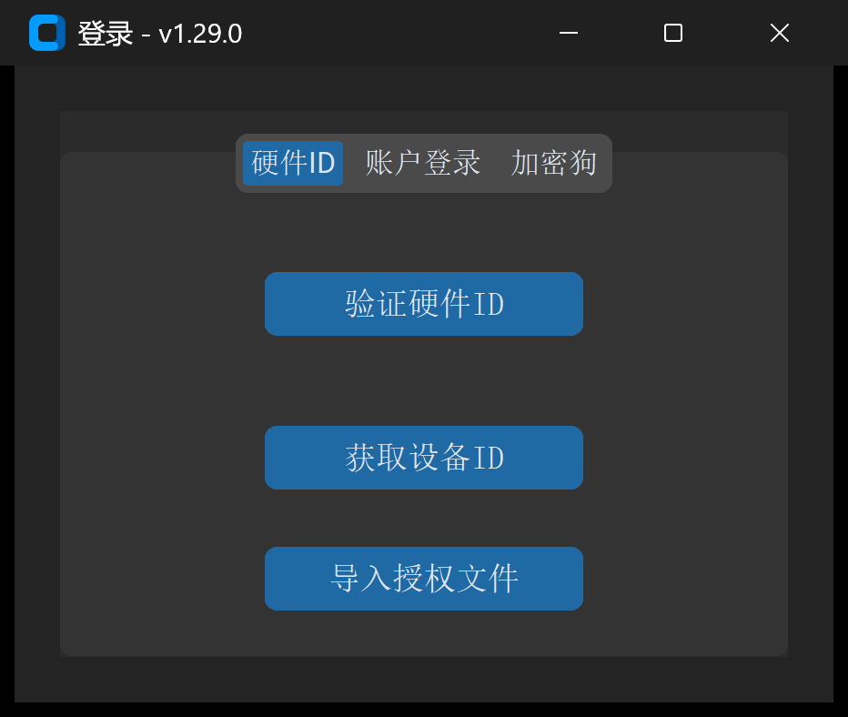
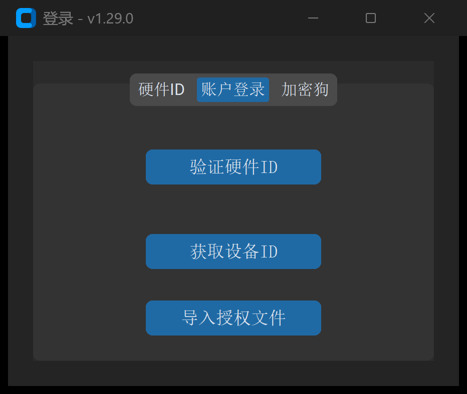
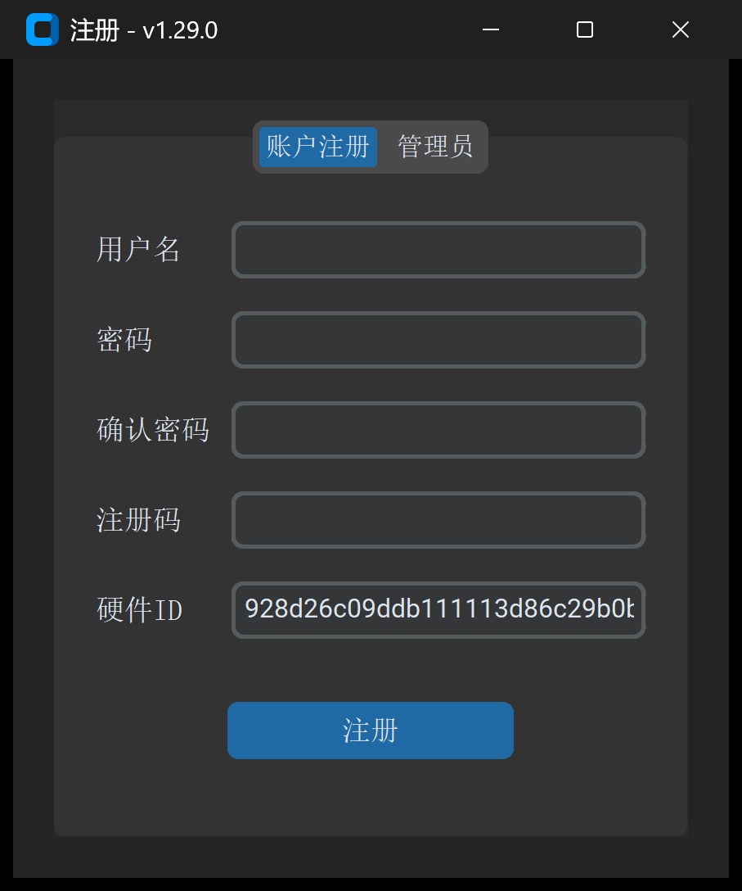
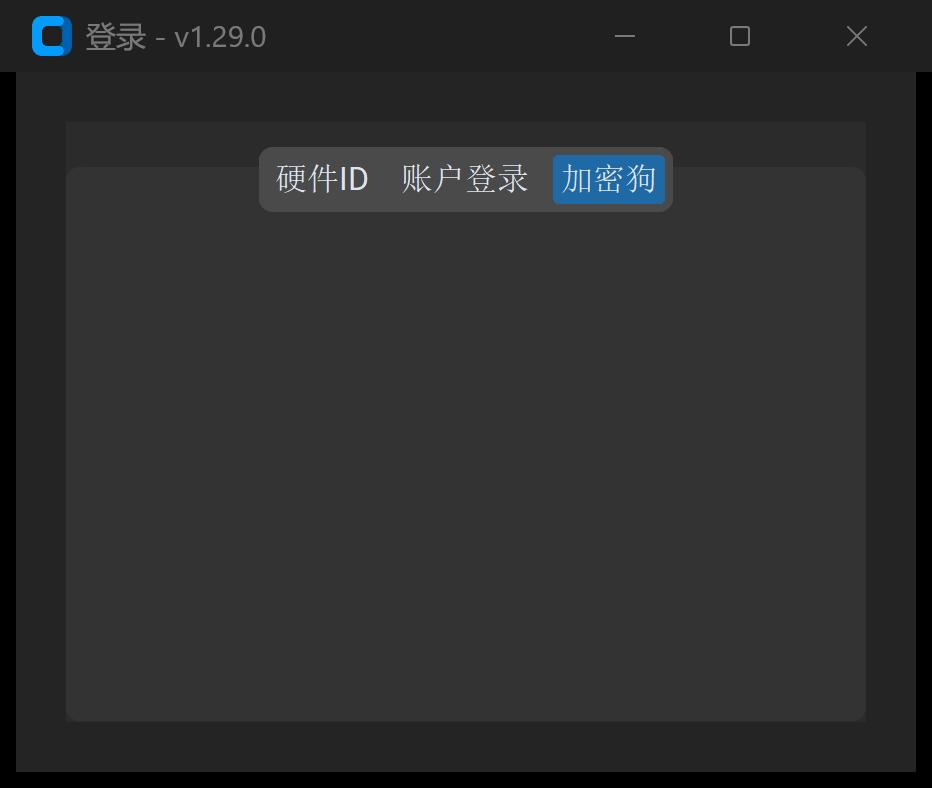
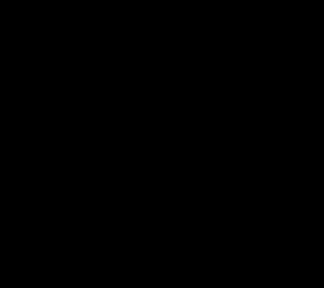

# 1.2 授权激活与版本升级

一句话说明：支持 Sentinel 硬件加密狗、Ed25519 离线许可文件、设备硬件 ID 及云端账户四种授权模式，并提供一键在线更新与历史日志查看。

---

## 四通道授权登录体系

若启动时未插入硬件加密狗，软件将弹出 `登录 - v1.29.0` 窗口。窗口包含 3 个选项卡：

### 1. 通道一：硬件 ID 与离线授权文件（推荐离线生产机床）

* **获取设备序列号**：
  * 点击 `获取设备ID` 按钮，弹出硬件序列号弹窗，一键复制本机唯一硬件指纹。
  * 将硬件序列号发送给管理员或售后支持人员开通许可。
* **在线验证**：
  * 若车间数控电脑已联网，开通后点击 `验证硬件ID` 即可一键激活。
* **离线许可文件导入（`导入授权文件`）**：
  * 适用于完全物理隔离的机床工控机。
  * 将技术支持签发的数字签名许可文件（`cg_license.lic`，基于 Ed25519 强加密体系）复制到本机。
  * 点击 `导入授权文件` 按钮，选择该 `.lic` 文件，系统核验通过后立即解锁并进入主窗口。

### 2. 通道二：账户登录与用户注册

* **账户登录**：
  * 输入授权用户名与密码，点击 `登录` 按钮。
  * 支持回车键（Enter）快捷提交登录。
* **用户注册**：
  * 点击 `注册` 按钮，调出 `注册 - v1.29.0` 独立窗口。
  * 窗口提供 `账户注册` 与 `管理员` 两大选项卡。
  * 填入用户名、密码、注册码及硬件序列号，点击 `提交注册` 即可完成绑定。

### 3. 通道三：硬件加密狗免登授权

* **免登直通**：
  * 将授权的 Sentinel SafeNet USB 加密狗插入电脑。
  * 启动软件时系统将静默识别，无需在登录界面停留，直接进入主窗口。
* **登录界面补验**：
  * 若先打开了登录界面，插入加密狗后切换至 `加密狗` 选项卡，点击 `验证加密狗` 即可直接登入。
* **实时断开检测与状态栏提示**：
  * 成功通过加密狗登入后，主界面底部常驻状态栏：`🟢 加密狗授权已激活`。
  * 软件内置 3 秒心跳守护线程，若在加工代码生成或重要计算过程中拔出加密狗，系统将立即安全锁定以防误操作。

---

## 软件版本升级与日志查看

### 检查更新

* 点击顶部菜单栏 `设置` -> `检查更新`。
* 软件自动比对远程版本服务器。若发现新版本，弹出更新引导并下载升级包。

### 查看更新日志

* 点击顶部菜单栏 `设置` -> `更新日志`。
* 软件直接调出版本变更日志弹窗，分类罗列当前与历史版本的优化项、新增功能与修复清单。

