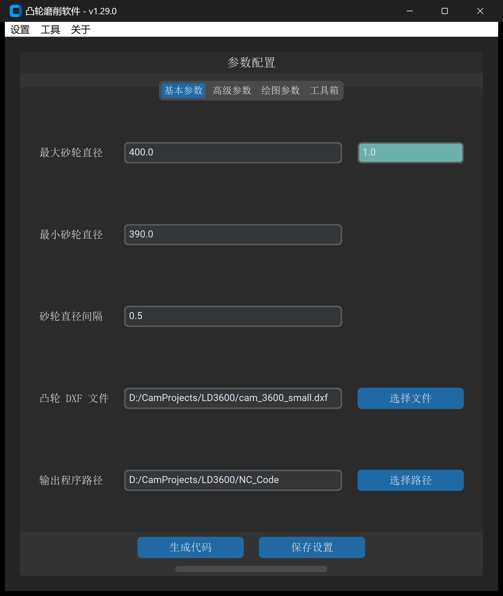

# 1.3 界面布局与菜单栏导览

一句话说明：主界面采用现代化暗黑主题与响应式布局，分为顶部菜单栏、功能选项卡区、动作执行按钮区与底部状态监控区四大板块。



---

## 主界面四大核心分区

| 分区名称 | 界面位置 | 核心功能与交互特性 |
| :--- | :--- | :--- |
| **1. 顶部菜单栏** | 窗口最顶端 | 提供系统设置、多语言实时切换、零件库工艺档案管理与在线技术支持。 |
| **2. 功能选项卡区** | 主工作区中央 | 容纳 4 大顶级选项卡（`基本参数`、`高级参数`、`绘图参数`、`工具箱`）及其下级子面板。 |
| **3. 动作执行与进度区** | 选项卡下方 | 包含动态主执行按钮（根据当前选中标签自动变换功能）、`保存设置` 按钮与计算进度条。 |
| **4. 授权状态栏** | 窗口最底部 | 实时显示加密狗连接状态（`🟢 加密狗授权已激活`）或会话许可状态。 |

---

## 顶部菜单栏结构详解

```text
菜单栏 (menu_bar)
├── 设置 (settings)
│   ├── 中文 / English       # 界面语言一键即时切换（免重启）
│   ├── 检查更新              # 检查新版本发布与在线下载
│   └── 更新日志              # 调出版本历史变更对话框
├── 工具 (menu_tools)
│   └── 零件库 (零件库)       # 打开独立零件工艺库配置管理窗口
└── 关于 (about)
    ├── 官方网站              # 浏览器跳转至 https://cg.niekun.net/
    ├── 用户手册              # 浏览器跳转至 https://cg-manual.niekun.net/
    └── 关于我们              # 弹出开发团队版权与官方联系信息
```

---

## 动态动作按钮与进度反馈机制

### 1. 动态自适应主执行按钮 (`submit_button`)

窗口底部的执行按钮根据当前选中的**最末级子标签页**自动切换文本与执行路由：

* 处于 `基本参数` 或 `高级参数`：显示为 **`生成代码`**
* 处于 `绘图参数` 各子标签：显示为 **`生成凸轮数据`**
* 处于 `工具箱 -> 凸轮分析 -> 凸轮转升程曲线`：显示为 **`生成升程数据`**
* 处于 `工具箱 -> 凸轮分析 -> 曲线转公式方程`：显示为 **`生成公式方程数据`**
* 处于 `工具箱 -> 加工误差 -> 加工误差修正`：显示为 **`生成修正凸轮数据`**
* 处于 `工具箱 -> 加工误差 -> 直径误差分析`：显示为 **`生成分析数据`**
* 处于 `工具箱 -> 加工误差 -> CAM 误差叠加`：显示为 **`生成叠加凸轮数据`**
* 处于 `工具箱 -> 加工误差 -> CAM 误差对比`：显示为 **`生成对比数据`**
* 处于 `工具箱 -> DXF 处理 -> DXF 文件对比`：显示为 **`生成对比 DXF`**
* 处于 `工具箱 -> DXF 处理 -> DXF 离散化`：显示为 **`生成离散化数据`**
* 处于 `工具箱 -> DXF 处理 -> DXF 拟合圆弧`：显示为 **`生成拟合数据`**

### 2. 独立参数持久化按钮 (`save_params_button`)

* 点击 **`保存设置`** 按钮，系统立即将当前面板中填入的全部参数固化写入本地 JSON 配置文件。
* 即使不点击执行计算，设置值也不会丢失，下次启动时自动恢复。

### 3. 多核并行进度与结果自动定位

* **多核计算进度条**：
  * 在执行大批量砂轮步距的代码生成时，进度条实时滚动并呈现当前正在计算的砂轮分段编号。
* **计算完成自动定位输出目录**：
  * 任何计算任务完成后，软件弹出成功对话框。
  * 用户点击“确定”后，软件自动调用 Windows 资源管理器直接打开并高亮定位输出的文件夹或文件。

