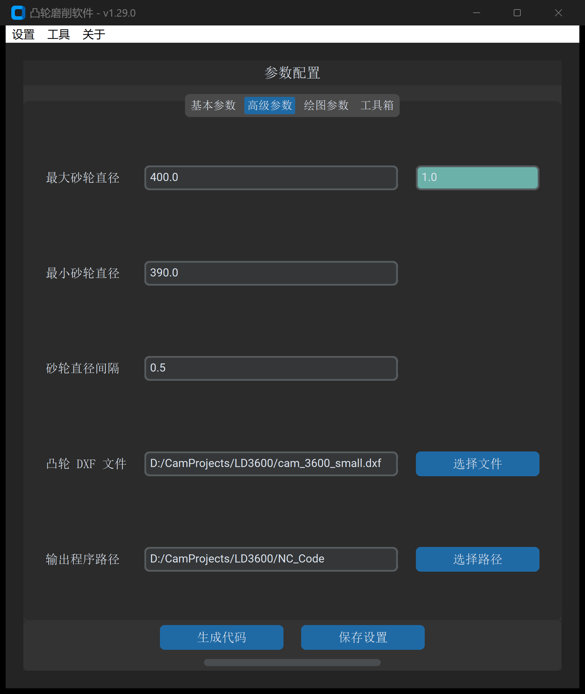

# 2.3 高级参数与算法配置

一句话说明：配置程序头注释信息、轮廓采样精度、圆弧拟合逼近误差、圆弧插补方向反转及西门子程序加密保护。

---

## 高级参数速查表

| 参数名称 | 默认值 / 单位 | 校验范围 | 作用与工程设置要点 |
| :--- | :--- | :--- | :--- |
| **`程序头信息`** | 多行文本 | 字符串 | 写入 CNC 程序顶部的注释说明。系统自动在每行开头追加分号（`;`），可用于记录工件编号、工艺要求、编程者及时间。 |
| **`DXF 读取精度`** | `0.01` mm | $\le 0.1$ mm | 读取 DXF 样条/线段时的离散步长。数值越小，离散点密度越高。精密凸轮推荐设为 `0.005` mm。若输入 $>0.1$，系统将报错拦截。 |
| **`程序点数量`** | `3600` | 正整数 | 离散点插补模式下，工件旋转一圈生成的等距程序点总数。通常设为 `3600`（即平均每 $0.1^\circ$ 一个插补点）。 |
| **`拟合圆弧`** | `否` | `否` / `是` | 是否将离散轮廓转换为连续相切圆弧插补段（西门子 TRANSMIT 模式）。选 `是` 可极大缩小程序体积并提升工件光洁度。 |
| **`G3 ⇆ G2`** *(拟合圆弧右侧复选框)* | 关 (0) | 开 / 关 | **圆弧插补代码方向反向切换**。 默认顺时针走向输出 $G02$。某些磨床的坐标轴定义中，砂轮架运动正方向与常规机床相反，勾选后将自动对调生成的 $G02$ 与 $G03$ 指令。 |
| **`拟合误差`** | `1` | 正数 | **圆弧拟合最大允许偏差**。 单位换算：实际最大允许误差为 $0.0001 \times \text{拟合误差}$ mm。即输入 `1` 代表允许最大弓高误差为 **$0.0001\ \text{mm}$（$0.1\ \mu\text{m}$）**。设置越小精度越高，但拟合圆弧段数会相应增多。 |
| **`Siemens程序加密`** | 关 (0) | 开 / 关 | 对生成的西门子 `.SPF` 程序调用 `pt.dat` 执行底层加密，生成机床端受保护程序，防止现场工艺代码泄露。 |

---

## 关键算法机制说明

> [!NOTE]
> **“程序点数量”与“拟合圆弧”的联动机制**
> * 当 `拟合圆弧` 选择 **`否`** 时，CNC 程序段严格由 `程序点数量` 决定（输出对应数量的 $G01$ 离散点）。
> * 当 `拟合圆弧` 选择 **`是`** 时，底层圆弧拟合引擎自动采用固定 3600 个基准离散点进行高精度双圆弧平滑逼近，最终输出的圆弧段数由 `拟合误差` 动态收敛决定。

> [!TIP]
> **拟合误差经验推荐值**
> * **一般凸轮（公差 $\pm 0.02\ \text{mm}$）**：`拟合误差` 填入 `10`（即允许 $1\ \mu\text{m}$ 误差），圆弧段数通常在 20~40 段。
> * **精密凸轮（公差 $\pm 0.005\ \text{mm}$）**：`拟合误差` 填入 `1`（即允许 $0.1\ \mu\text{m}$ 误差），拟合轮廓与理论轮廓完全重合。

