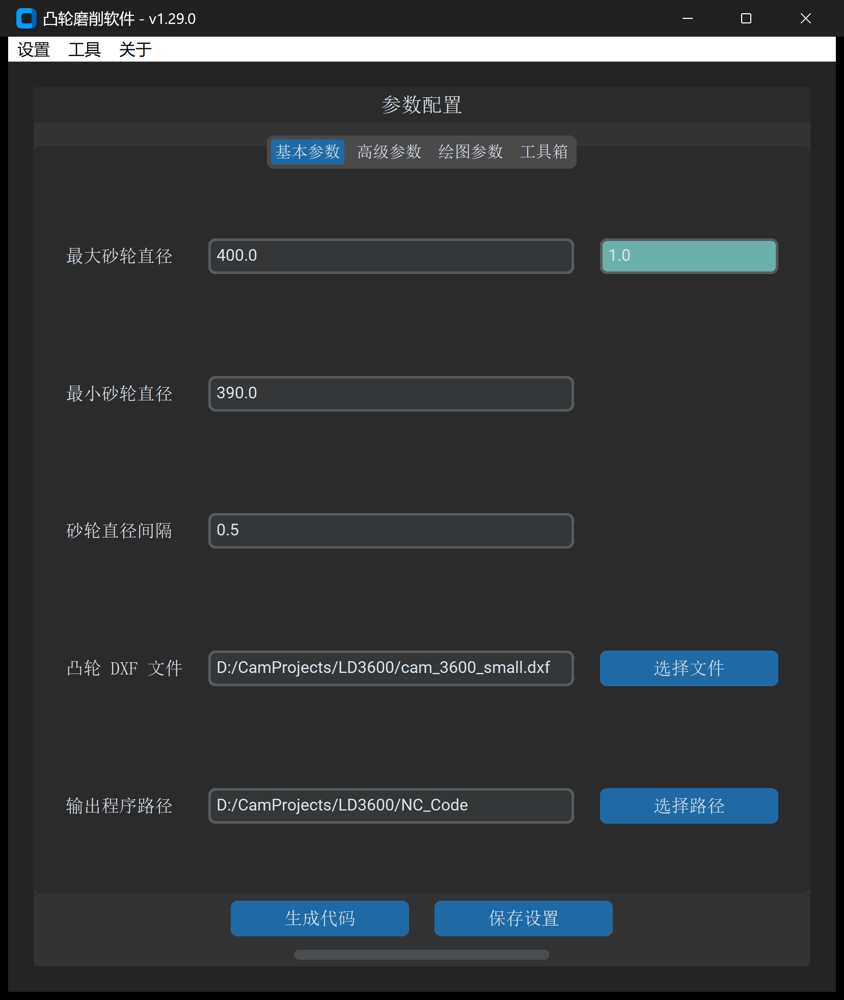

# 2.2 基本参数配置详解

一句话说明：设定砂轮直径变化范围、磨削补偿步距以及凸轮图纸与程序输出路径。

---

## 基本参数速查表

| 参数名称 | 默认值 / 单位 | 校验规则 | 作用与工程设置要点 |
| :--- | :--- | :--- | :--- |
| **`最大砂轮直径`** | `400.0` mm | 必须大于最小砂轮直径 | 新装砂轮或当前砂轮的初始磨损起始直径。 |
| **`砂轮直径误差修正`** *(输入框右侧青色区域)* | `0.0` mm | 允许正负实数 | **直径误差快速修复值**。 当数控系统记录的砂轮直径与现场实测直径存在固定系统偏差时，直接填入 `[实际直径 - 系统设置直径]`，无需更改系统变量即可消除轮廓形变误差。 |
| **`最小砂轮直径`** | `300.0` mm | 必须大于 0 | 砂轮允许使用的报废极限最小直径。 |
| **`砂轮直径间隔`** | `20.0` mm | 必须大于 0 | 砂轮修整补偿的步距。系统将以该步距在最大至最小直径区间内依次生成多段加工程序。粗加工可设 `1.0~5.0` mm，精密加工通常设 `0.1~0.5` mm。 |
| **`凸轮 DXF 文件`** | 空 (必填) | 必须为有效 `.dxf` 文件 | 导入待加工的闭合理论凸轮轮廓图纸。 |
| **`输出程序路径`** | 空 (必填) | 必须为有效文件夹路径 | 指定生成的 CNC 代码及辅助图表的存放目录。 |

---

## 标准操作步骤

1. **设置砂轮直径范围**：
   * 根据当前砂轮规格，填入 `最大砂轮直径`（如 `400.0`）与 `最小砂轮直径`（如 `390.0`）。
   * 根据加工精度等级设置 `砂轮直径间隔`（精密凸轮建议设为 `0.2` 或 `0.5` mm）。
2. **选择凸轮 DXF 图纸**：
   * 点击 `凸轮 DXF 文件` 旁的 `选择文件`，载入 CAD 轮廓。
3. **指定输出目录**：
   * 点击 `输出程序路径` 旁的 `选择路径`，指定目标保存文件夹。
4. **持久化保存与生成**：
   * 点击 `保存设置`，将参数保存到本地配置。
   * 点击 `生成代码`，启动多核后台代码生成。

> [!IMPORTANT]
> **输入校验约束**
> 若 `最大砂轮直径` 小于或等于 `最小砂轮直径`，点击生成时系统将弹出警告对话框：`“最大砂轮直径不能小于最小砂轮直径”`，请确保最大直径设置大于最小直径。

