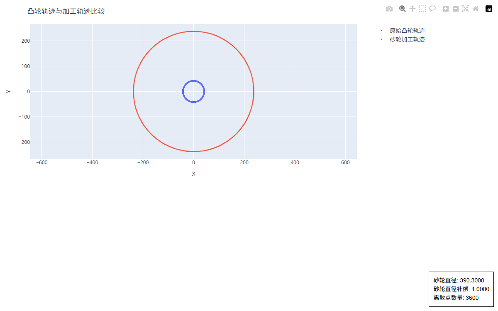
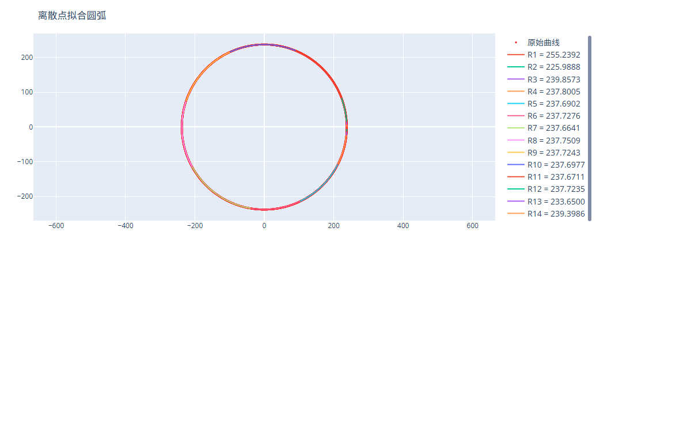

# 2.4 输出文件与交互图表

一句话说明：代码生成完成后自动创建以 `CV_<工件名>` 命名的工艺文件夹，汇集加工程序、校验图纸、离散报表及交互式网页图表。

---

## 输出目录结构解析

```text
CV_工件文件名/
├── CV_工件文件名.SPF                            # 西门子数控系统加工宏程序 (直接传至机床)
├── dxf_points_orignal.dxf                      # 软件离散化后的工件基准点图纸
├── dxf_points_orignal_polyline.dxf             # 多段线闭合工件轮廓图纸
└── 特定砂轮直径 (最大直径) 辅助校核文件：
    ├── dxf_points_wheel_center_390_3000.dxf    # 砂轮中心运动轨迹点位 DXF
    ├── dxf_points_wheel_center_390_3000_polyline.dxf
    ├── info_wheel_diameter_390_3000.txt        # 逐点坐标、半径差与角度增量明细表
    ├── plot_compare.html                       # 理论凸轮与砂轮中心轨迹对比交互式图表
    └── (若启用圆弧拟合，额外包含以下文件)：
        ├── fit_arcs_390_3000.dxf               # 拟合后平滑相切圆弧 DXF 图纸
        ├── fit_arcs_390_3000.html              # 圆弧拟合误差带与线段对比交互图表
        └── fit_arcs_390_3000.txt               # 每段圆弧的起点、终点、圆心坐标与半径列表
```

> [!NOTE]
> **多直径图表生成机制**
> 为保障多核并行计算的高速响应，无论设置了多少档砂轮直径，`.SPF` 加工程序均包含所有直径段的代码；而辅助校核图表（`.html`、`.txt`、轨迹 `.dxf`）仅针对**起始的第一档最大砂轮直径**生成。

---

## 交互式 Plotly 网页图表功能导览

软件生成的 `.html` 图表基于 Plotly 引擎构建，双击可在任何现代浏览器中打开，提供三项核心工程校核功能：

### 1. 凸轮曲线与加工运行曲线对比图 (`plot_compare.html`)



* **1:1 绝对等比例显示**：自动锁定 X 轴与 Y 轴物理比例尺（`scaleanchor="x"`），保证凸轮轮廓真实无畸变。
* **双击/滚轮缩放**：按住鼠标左键拉框局部放大，双击图表区域瞬间恢复全貌。
* **图例显隐**：点击右上角图例名称，可单独隐藏或显示工件轮廓线或砂轮中心线。
* **悬停探针**：鼠标移动到曲线上任意位置，实时浮现当前点的极角与极径坐标。

### 2. 圆弧拟合对比分析图 (`fit_arcs_<dia>.html`)



* **红绿双轨对比**：同屏叠加展示原始密集离散点（基准轨）与拟合圆弧段（优化轨）。
* **段落接刀点高亮**：清晰标注每段圆弧的起点与终点位置，便于工艺人员评估机床转弯过渡加速度。

---

## 加工程序 (`.SPF`) 代码结构剖析

### 1. COMPCAD 离散点插补模式代码片段

```gcode
;********************************
;砂轮直径范围:400.0000 - 390.0000
;砂轮步距:0.5
;软件版本:1.29.0
;********************************
STOPRE ; 停止预读
;--- 砂轮直径跳转表 ---
IF (WHEEL_DIA>=400.0000) GOTOF DIA_400_0000;
IF (WHEEL_DIA<400.0000) AND (WHEEL_DIA>=399.5000) GOTOF DIA_399_5000;
...
IF (WHEEL_DIA<390.5000) GOTOF DIA_390_0000;
;--------------------------------
DIA_400_0000:
G64 G90 G01
TRANS X=$AA_IM[X] C=$AA_IM[C]
COMPCAD
X=0.0000 C=DC(0.0000)
X=0.0000 C=DC(0.0116)
X=0.0001 C=DC(0.1252)
...
COMPOF
RET
```

### 2. TRANSMIT 圆弧拟合模式代码片段

```gcode
DIA_400_0000:
G64 G90 G01
$MC_TRANSMIT_BASE_TOOL_1[0]=$AA_IM[X]-247.3145
$MC_TRANSMIT_ROT_AX_OFFSET_1=$AA_IM[C]
NEWCONF
TRANSMIT
G01 X=247.3145 Y=0.0000
G02 X=247.2834 Y=-4.9551 CR=404.1318
G02 X=247.1428 Y=-11.3301 CR=350.4227
...
TRAFOOF ; 关闭坐标转换
RET
```

