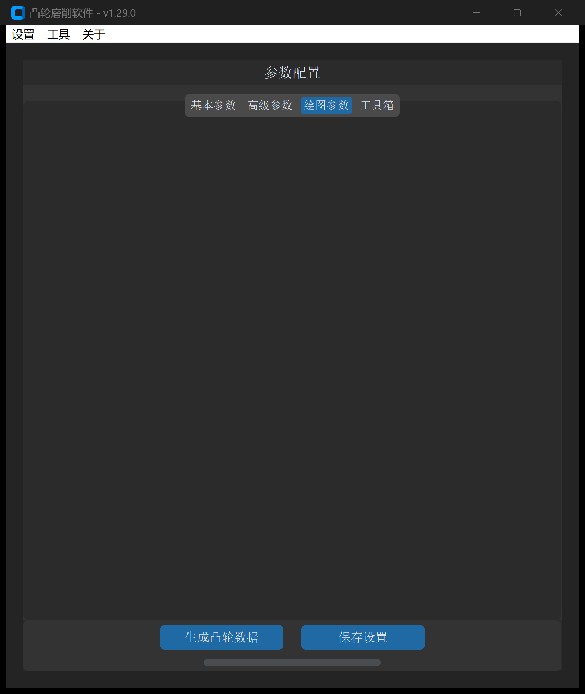
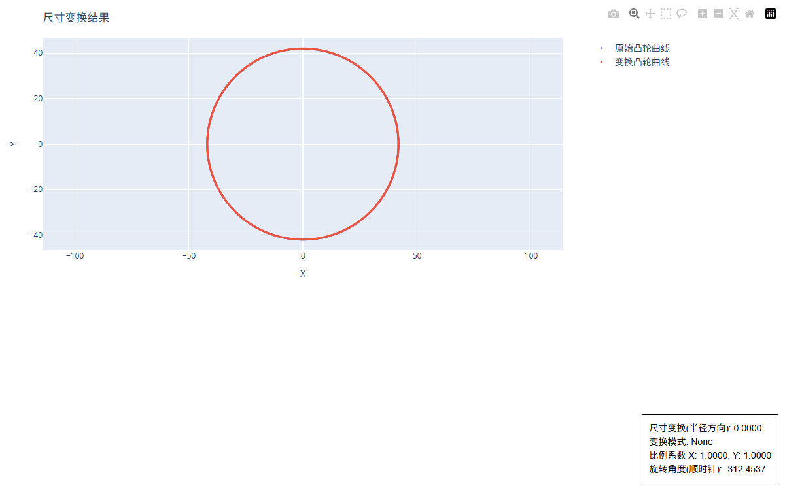

# CAM 共轭计算

“CAM 共轭计算”工具专门用于**共轭双凸轮机构（Conjugate Cam Mechanism）**的正向与反向包络设计。通过已知的基准凸轮（主凸轮）轮廓及双摆臂铰链机构几何参数，精确解算出消除传动间隙的配对共轭凸轮（副凸轮）工作轮廓。

---

## 1. 操作界面与参数布局

打开主界面并切换至 **绘图参数 -> CAM 共轭计算**：



---

## 2. 机构原理与几何模型

共轭凸轮机构广泛应用于高速剑杆织机、凸轮分割器、自动冲压机等重载高频自动化设备中。它通过两组刚性联动的摆臂和滚子，分别紧贴在主凸轮与副凸轮的表面，实现**无弹簧反求、双向正向驱动、零侧隙高刚度传动**。

```
       摆臂回转支点 O (中心距 L)
             / \
   摆臂 1  /   \  摆臂 2 (夹角 γ)
   (长 l₁) /     \ (长 l₂)
          /       \
      滚子 1     滚子 2 (半径 r_r)
       (●)        (●)
        |          |
    [主凸轮 1]  [共轭凸轮 2] (同轴同步旋转)
           \      /
            \    /
           凸轮轴心 C(0, 0)
```

### 机构参数对应关系

* **$C(0,0)$**：凸轮旋转中心（原点）；
* **$O$**：双摆臂机构回转支点，其与凸轮中心的水平距离即为**摆臂中心距 $L$**；
* **$l_1$**：接触主凸轮 1 的摆臂长度；
* **$l_2$**：接触共轭凸轮 2 的摆臂长度；
* **$\gamma$**：摆臂 1 到摆臂 2 之间的夹角；
* **$r_r$**：随动滚子半径。

---

## 3. 参数定义与配置说明

| 参数项 | 字段标识 | 示例取值 | 详细说明与工程含义 |
| :--- | :--- | :--- | :--- |
| **原始凸轮文件** | `original_cam_file` | `*.dxf` | 已知的主凸轮（凸轮 1）DXF 轮廓文件 |
| **摆臂中心距** | `pivot_distance` | `110.0` | 摆臂回转支承轴心到凸轮轴心之间的中心距离 $L$（$\text{mm}$）。<br>• **正值**：支点位于凸轮中心右侧；<br>• **负值**：支点位于凸轮中心左侧 |
| **滚子半径** | `roller_radius` | `16.0` | 摆臂末端装配的从动滚子半径 $r_r$（$\text{mm}$） |
| **凸轮1摆臂长度** | `cam_1_pendulum_length` | `75.0` | 接触主凸轮 1 的摆臂有效力臂长度 $l_1$（$\text{mm}$） |
| **凸轮2摆臂长度** | `cam_2_pendulum_length` | `75.0` | 接触共轭凸轮 2 的摆臂有效力臂长度 $l_2$（$\text{mm}$） |
| **摆臂夹角** | `cam_pendulums_angle` | `60.0` | 两摆臂中心线之间的几何夹角 $\gamma$（度）：<br>• **逆时针为正**（摆臂 1 逆时针转向摆臂 2）；<br>• **顺时针为负** |
| **DXF 保存地址** | `output_path` | 必填 | 求解生成的配对共轭凸轮 DXF 文件路径 |

---

## 4. 求解算法与包络特性

软件底层采用基于机构运动学反转法的**连续性接触包络求解器**：

1. **运动学反转**：假定主凸轮 1 保持静止，双摆臂支座 $O$ 绕凸轮轴心以步距 $\Delta \theta = 0.5^\circ$ 进行反向相对回转；
2. **接触轨迹追踪**：基于非线性距离极值方程，实时追踪滚子 1 贴合在凸轮 1 表面的动态切点 $P_1$，求出双摆臂的摆角响应序列 $\psi(\theta)$；
3. **刚体位姿传递**：根据固定夹角 $\gamma$ 和力臂长度 $l_2$，推导计算出滚子 2 的理论几何中心轨迹 $P_2(\theta)$；
4. **包络线与去噪滤波**：求取滚子 2 的接触族包络线，并激活自适应解缠绕（Unwrap）与中位距离离群点过滤算法（阈值倍数 2.0），剔除反向拐点自交虚根，输出光滑闭合的共轭工作轮廓。

---

## 5. 输出成果与交互校验

点击 **生成凸轮数据** 后，系统将同步生成共轭副凸轮的 DXF 轮廓与交互式装配校验图：



> [!NOTE]
> 在生成的 HTML 交互图表中，蓝色曲线为主凸轮轮廓，橙色曲线为生成的共轭凸轮轮廓。通过鼠标悬停可实时读取主从凸轮在任意工作相位下的瞬时接触点与摆臂位置，验证机构全行程内无干涉与死点。

