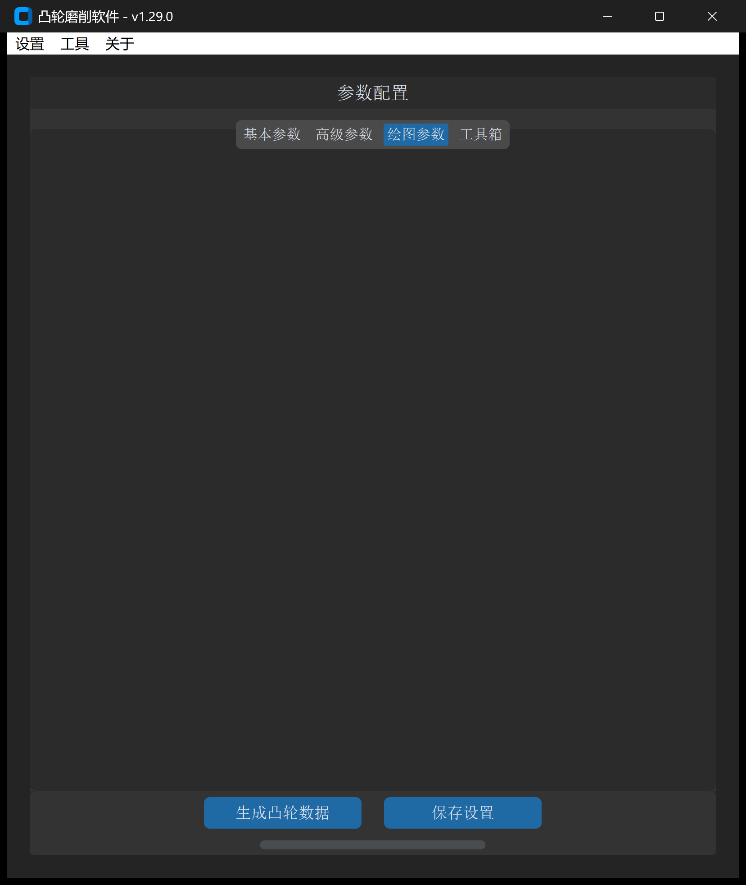

# CAM 数据文件建模

“CAM 数据文件”工具用于根据给定的**升程规律（Lift Table）**、**基圆半径**以及**随动件滚子直径**，自动反求并绘制出高精度的凸轮工作轮廓 DXF 文件。

---

## 1. 操作界面与参数布局

打开主界面并切换至 **绘图参数 -> CAM 数据文件**：



---

## 2. CAM 数据文件语法与格式规范

CAM 数据文件是工业界常用的结构化描述文本，支持直接使用标准文本文件（`.txt`）或 Excel 表格（`.xlsx`）进行组织。

### 2.1 基础标记符语法

标准文本格式由三个核心指令标识符构成：

```text
B,25.0              ; [B] 基圆半径 (Base Circle Radius) 为 25mm
G,12.0              ; [G] 测杆滚轮半径 (Roller Radius) 为 12mm

A,0,90,10           ; [A] 角度定义：0度到90度，步距10度（共10个数据点）
0.0                 ; 0度升程
0.25                ; 10度升程
0.85                ; 20度升程
1.80                ; 30度升程
3.10                ; 40度升程
4.75                ; 50度升程
6.70                ; 60度升程
8.90                ; 70度升程
11.20               ; 80度升程
13.50               ; 90度升程

A,90,180,10         ; 远休止区：90度到180度
13.50               ; 若该段只写一行数值，系统将自动识别为该区间内升程恒定

A,180,360,10        ; 回程与近休止区
13.0
11.5
...
0.0
```

* **`B` 标识符**：指定凸轮名义基圆半径 $R_b$。
* **`G` 标识符**：指定测杆或从动件滚子半径 $r_r$：
  * 若输入的数据已经是凸轮**本体实际轮廓**，则将滚子半径设为 `0`；
  * 若机构采用**平底从动件（平面随动件）**，理论上可近似输入一个远大于基圆的等效滚子半径（例如 10 倍基圆半径）；
  * 若输入的是滚子中心运动轨迹，设置实际滚子半径后系统会自动包络求解工作轮廓。
* **`A` 标识符**：指定一个连续角度区间，后接三项参数：`起始角度, 终止角度, 角度步距`。在该标识符下方依次输入每个离散角度的升程数值。

---

## 3. 参数定义与配置说明

| 参数项 | 字段标识 | 推荐设置 | 说明与功能 |
| :--- | :--- | :--- | :--- |
| **CAM 数据文件地址** | `cam_data_file_path` | 必填 | 包含 `B/G/A` 标记的 `.txt` 文本或规范排版的 `.xlsx` 文件路径 |
| **数据角度方向** | `cam_data_direction` | 逆时针 | 文本中角度增长方向：以 X 轴正向为基准，分为**顺时针**与**逆时针** |
| **数据类型** | `cam_data_type` | 绝对值 | • **绝对值**：文件中升程为以基圆为 0 的绝对值，直接与基圆相加；<br>• **相对值**：自动查找全周升程最小值，将其平移归零后再与基圆叠加 |
| **比例系数** | `scale_factor` | `1.0` | 整体放大、缩小或轴向镜像系数（负值实现镜像） |
| **图形旋转角度** | `graph_rotate_angle` | `0` | 最终生成的凸轮轮廓在平面内的旋转角度（顺时针为正，逆时针为负） |
| **绘制升程图形** | `draw_lift` | 勾选 | 勾选后输出交互式 HTML 运动学波形及克林伯格 P65 数据 |
| **基圆半径** | `base_circle_radius` | 自动/手动 | 若数据文件中未包含 `B` 指令，可在此手动输入基圆半径（mm） |
| **升程方向** | `lift_direction` | 顺时针 | 极坐标展开方向，推荐保持顺时针以便与机床加工坐标对齐 |
| **X 轴缩放** | `lift_curve_x_axis_scale` | `1.0` | HTML 交互图表横轴显示缩放倍数 |
| **DXF 保存地址** | `output_path` | 必填 | 目标生成 DXF 文件的保存路径 |

---

## 4. 建模与工程验证流程

1. **导入与解析**：在界面选择待处理的 CAM 数据文件，点击解析；
2. **基圆与从动件确认**：校验基圆半径与滚子半径是否与机械设计图纸相符；
3. **闭合性与平滑度检查**：
   * 检查起始角（$0^\circ$）与终止角（$360^\circ$）升程是否连续平滑闭合；
   * 检查生成的 HTML 交互图表中的速度曲线与加速度曲线是否存在突变台阶（防止机构发生刚性冲击或柔性冲击）；
4. **生成 DXF**：点击 **生成凸轮数据**，生成符合数控磨床编程要求的闭合轮廓。

