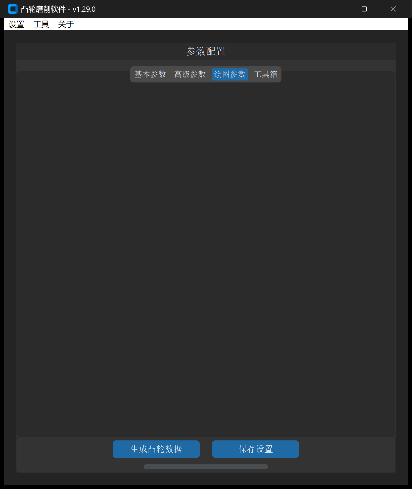

# CAM 图形变换

“CAM 图形变换”工具用于对已有的凸轮 DXF 轮廓进行精确的几何与尺寸重构，支持**极径方向放缩**、**法线方向等距偏置**、**全局比例缩放**以及**坐标系旋转**。

---

## 1. 操作界面与参数布局

打开主界面并切换至 **绘图参数 -> CAM 图形变换**：



---

## 2. 参数定义与配置说明

| 参数项 | 字段标识 | 默认值 | 详细说明与推荐配置 |
| :--- | :--- | :--- | :--- |
| **原始凸轮文件** | `original_cam_file` | 必填 | 待处理的既有凸轮轮廓 DXF 文件路径 |
| **尺寸变换值** | `size_change` | `0.0` | 几何尺寸增减量（单位：$\text{mm}$）：<br>• **正值**：外扩 / 增大轮廓；<br>• **负值**：内缩 / 减小轮廓 |
| **尺寸变换模式** | `size_change_mode` | 极径方向 | 核心变换模式选择（极径方向 vs 法线方向），二者几何含义截然不同（详见第 3 节） |
| **比例系数** | `scale_factor` | `1.0` | 几何整体缩放比例（支持负值实现镜像） |
| **图形旋转角度** | `graph_rotate_angle` | `0` | 平面内绕原点旋转角度（正值为顺时针，负值为逆时针） |
| **DXF 保存地址** | `output_path` | 必填 | 变换后新凸轮 DXF 文件的保存路径 |

---

## 3. 极径变换与法线变换的工程区别

选择变换模式时，必须根据机械运动学需求严格区分：

```
极径方向变换 (Polar Offset):
P_new(θ) = (r(θ) + Δr) · [cos θ, sin θ]^T
特点：升程波形 h(θ) 保持恒定，仅基圆半径变大或变小。

法线方向变换 (Normal Offset):
P_new = P + Δd · n
特点：曲线上每点沿瞬时单位法向量 n 偏置，工作升程波形会发生非线性改变。
```

### 3.1 极径方向变换（Radial / Polar）

* **变换原理**：以旋转中心（$0,0$）为基准，保持各转角 $\theta$ 不变，使轮廓极径直接增减 $\Delta r$。
* **工程特征**：新凸轮与原凸轮的**运动学升程曲线完全相同**。
* **典型应用**：
  * 在保持凸轮机构推程速度、加速度不变的前提下，增大或减小基圆半径以改善压力角；
  * 配合车削/粗磨工序添加各向均匀的加工余量。

### 3.2 法线方向变换（Normal Offset）

* **变换原理**：沿轮廓表面每一离散微元处的法向矢量 $\vec{n}$ 平移距离 $\Delta d$。
* **工程特征**：法向偏置会改变轮廓的局部曲率。外凸部位曲率半径变大，凹陷部位曲率半径变小，**升程波形不再与原凸轮重合**。
* **典型应用**：
  * **滚子中心轨迹与凸轮廓线互换**：已知从动件滚子中心理论轨迹，沿法向内缩滚子半径 $r_r$（即输入负值），即可生成实际凸轮加工工作轮廓；
  * **砂轮磨损与半径补偿**：在固定路径磨削中，根据磨损量直接重构法向等距偏置线。

---

## 4. 操作步骤

1. 点击 **选择** 导入基准凸轮 DXF 文件；
2. 输入 **尺寸变换值**，并选择所需的 **尺寸变换模式**（极径或法线）；
3. 若需微调起始相位，在 **图形旋转角度** 中输入旋转角度；
4. 指定 **DXF 保存地址**，点击 **生成凸轮数据** 完成重构；
5. 生成完毕后，可在 CAD 软件或在主界面查看新旧曲线的对比效果。

