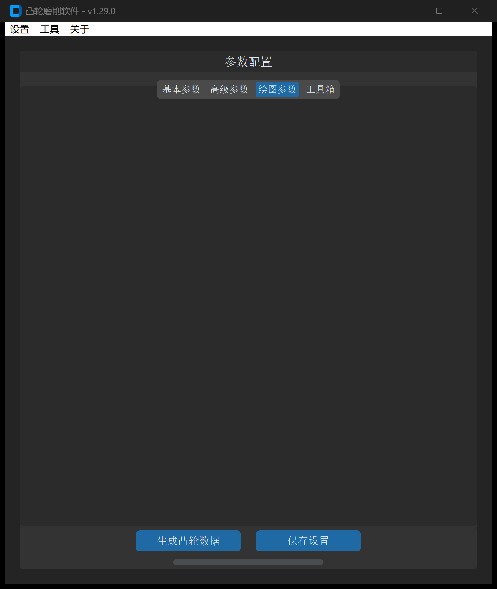
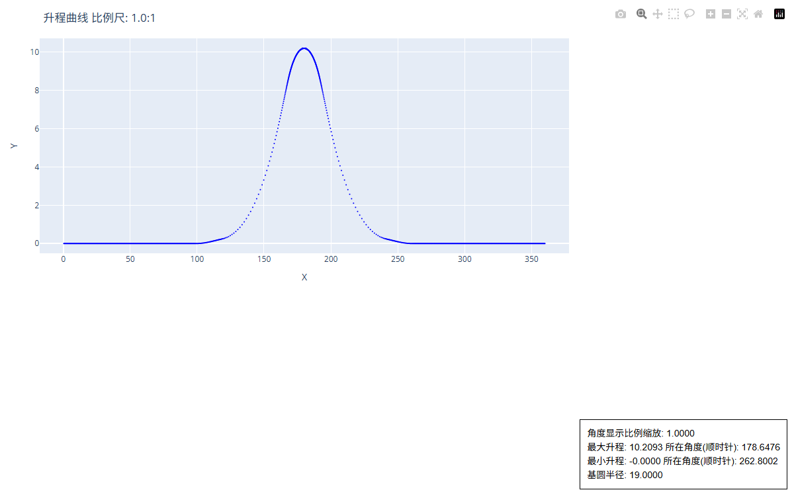

# XY 点位文件建模

“XY 点位文件”工具用于将离散的二维笛卡尔坐标点列（例如三坐标测量机扫描点、光学反求点或数学计算点）转换为符合工业标准的闭合凸轮 DXF 文件，并在生成过程中同步计算运动学升程曲线。

---

## 1. 操作界面与参数布局

打开主界面并切换至 **绘图参数 -> XY 点位文件**：



---

## 2. 参数定义与配置说明

| 参数项 | 界面字段 / 标识 | 默认值 | 详细说明与推荐配置 |
| :--- | :--- | :--- | :--- |
| **选择类型** | `points_choice_type` | 单文件 | **单文件**：处理单一 `.txt` 或 `.dat` 点位数据文件；<br>**文件夹**：批量读取指定目录下所有离散数据并串联重构 |
| **XY 点位数据地址** | `points_file_path` | 无 | 输入源文件或源目录的完整本地路径（支持点击“选择”浏览） |
| **XY 数据索引号** | `points_data_index` | `01` | 指定每行文本中属于 X 和 Y 坐标的字段索引（从 0 开始计数）：<br>• `01`：第 0 列为 X，第 1 列为 Y（最常用）；<br>• `56`：第 5 列为 X，第 6 列为 Y（适用于带时间、角度、速度的多列格式） |
| **交换 XY 数据** | `points_exchange_xy` | 否 | 若选择“是”，则强制将提取的第 1 个坐标视作 Y，第 2 个坐标视作 X |
| **比例系数** | `scale_factor` | `1.0` | 几何缩放倍数：<br>• `1.0`：保持原始尺寸；<br>• `25.4`：英寸转公制毫米；<br>• `-1.0`：实现轴向镜像操作 |
| **图形旋转角度** | `graph_rotate_angle` | `0` | 绕坐标原点（$0,0$）旋转凸轮角度（度）：<br>• **正值**：顺时针旋转；<br>• **负值**：逆时针旋转 |
| **绘制升程图形** | `draw_lift` | 勾选 | 勾选后，软件自动计算并输出动态升程、速度、加速度交互图表及 P65 升程文本 |
| **基圆半径** | `base_circle_radius` | `20.0` | 凸轮理论基圆半径（mm）。升程计算以该半径为基准面进行偏移分离 |
| **升程方向** | `lift_direction` | 顺时针 | 极坐标展开计算的旋转方向。由于外圆凸轮磨床主轴加工多为顺时针进给，**推荐保持顺时针**以便于加工比对 |
| **X 轴缩放** | `lift_curve_x_axis_scale` | `1.0` | 针对 HTML 交互图表中的 X 轴（转角或行程）显示比例。升程变化极小（$< 0.5\ \text{mm}$）时，调小该值有助于拉伸波形观察 |
| **DXF 保存地址** | `output_path` | 必填 | 目标生成 DXF 文件的保存路径 |

---

## 3. 点位文件格式规范与容错

软件底层内置了强大的文本解析器，能够自动过滤表头、注释与非数值行：

### 规范数据示例（标准双列）

```text
15.0000    0.0000
14.8781   -0.3763
14.7518   -0.7512
14.6211   -1.1245
14.4860   -1.4963
...
```

### 多列复合数据示例（设置索引为 `56`）

```text
=====================================================================================
  t       a       V       s    Rbig      Xb       Yb      Rs       Xs       Ys
=====================================================================================
0.0000, 0.0000, 0.00000, 0.0000, 99.0800, -64.1672, -75.4945, 148.5000, -100.1537, 109.6426
1.0000, 3.6884, 0.00310, 0.0001, 99.0802, -62.8400, -76.6030, 148.4998, -102.0518, 107.8778
2.0000, 7.2052, 0.01220, 0.0008, 99.0818, -61.4944, -77.6894, 148.4983, -103.9176, 106.0796
...
```

> [!TIP]
> 软件支持逗号（`,`）、空格（` `）及制表符（`\t`）作为列分隔符。遇到带分隔线或说明文字的表头时，系统会自动尝试数值转换，失败行将静默跳过，无需用户手动删改原文件。

---

## 4. 输出成果与交互图表

点击 **生成凸轮数据** 后，系统将产出以下成果：

1. **工业级 DXF 文件**：包含按指定方向闭合的完整轮廓，自动校准起点相位。
2. **克林伯格 P65 升程文件（`*-distance-*.txt`）**：格式与齿轮测量中心/凸轮测量仪完全匹配，包含 $0^\circ \sim 360^\circ$ 步距 $0.5^\circ$ 的标准升程值。
3. **交互式升程图表（HTML）**：在本地浏览器自动弹出或保存于输出目录，提供极高分辨率的升程与曲率质量诊断：



