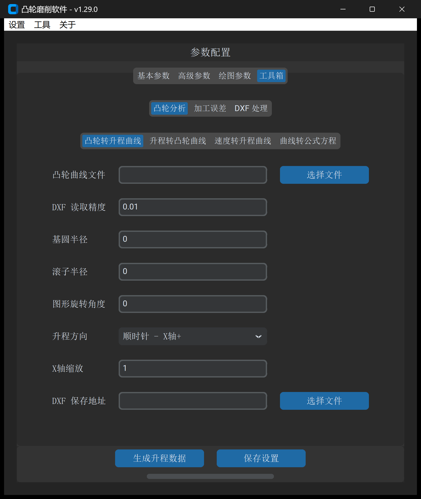
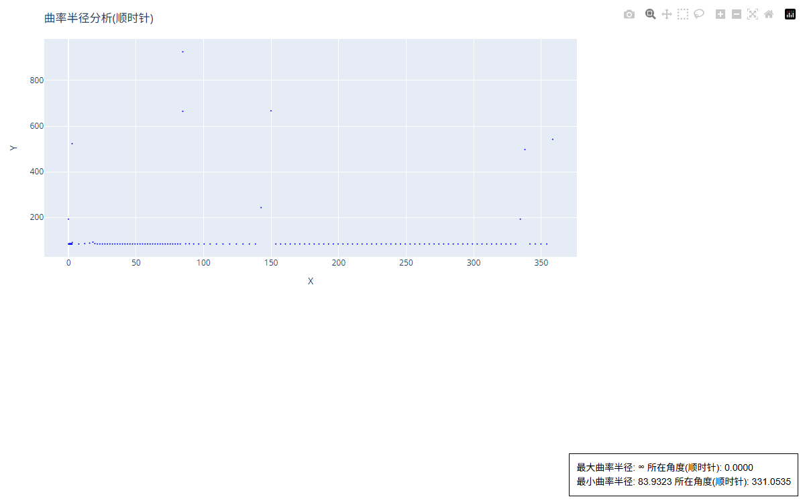

# 凸轮转升程曲线

“凸轮转升程曲线”工具用于从既有的凸轮 DXF 轮廓中，反求从动件在各转角下的**升程（Lift）**、**速度（Velocity）**、**加速度（Acceleration）**以及轮廓表面的**曲率半径（Curvature Radius）**，并自动生成适用于克林伯格（Klingelnberg P65）等凸轮测量仪的升程对齐文件。

---

## 1. 操作界面与参数布局

打开主界面并切换至 **工具 -> 凸轮分析 -> 凸轮转升程曲线**：

---

## 2. 参数定义与配置说明

| 参数项 | 字段标识 | 推荐设置 | 详细说明与工程含义 |
| :--- | :--- | :--- | :--- |
| **凸轮曲线文件** | `curve_dxf_file_path` | 必填 | 待分析的既有凸轮 DXF 闭合轮廓文件路径 |
| **基圆半径** | `base_circle_radius` | `20.0` | 凸轮设计基圆半径（$\text{mm}$）。软件以该基圆为零位基准，求取向外的绝对/相对升程 |
| **滚子半径** | `roller_radius` | `0.0` | 测量杆探针或机构滚子半径（$\text{mm}$）。 • 若输入凸轮实际轮廓且探针为对心尖顶或微小球面测头，设为 `0`； • 若分析配对摆臂滚子运动，输入滚子实际半径进行接触反包络求解 |
| **升程方向** | `lift_direction` | 顺时针 | 极坐标展开计算的方向（顺时针 / 逆时针）。外圆磨削通常沿顺时针推进，建议保持**顺时针** |
| **原始升程X轴缩放** | `original_lift_curve_x_axis_scale`| `1.0` | 生成的 HTML 交互图表中横坐标缩放倍数，便于展开观察微小升程 |

---

## 3. 数学解算与物理判据

系统在极坐标离散网格上对轮廓位置矢量 $\vec{r}(\theta) = [x(\theta), y(\theta)]^T$ 进行高阶样条重构与数值微分：

### 3.1 运动学微分

$$s(\theta) = \|\vec{r}(\theta)\| - R_{\text{base}}$$

$$v(\theta) = \frac{ds(\theta)}{d\theta}, \quad a(\theta) = \frac{d^2s(\theta)}{d\theta^2}$$

* **平滑度校验**：速度曲线 $v(\theta)$ 和加速度曲线 $a(\theta)$ 的连续性直接反映了凸轮传动的动力学品质。
* 若出现尖峰或跳变，表明原始 DXF 轮廓存在微小的折角或离散不均匀，磨削时会导致机床进给轴剧烈抖动。

### 3.2 轮廓曲率半径与砂轮干涉判据

$$\rho(\theta) = \frac{(x'^2 + y'^2)^{3/2}}{|x' y'' - y' x''|}$$

> [!CAUTION]
> **凹轮廓最小曲率半径预警**
> 
> 在上图所示的曲率分析曲线中，若凸轮存在内凹区域（曲率半径极小值点），该处的最小曲率半径 $\rho_{\min}$ **必须严格大于外圆磨削砂轮的半径 $R_w$**：
> $$\rho_{\min} > R_w = \frac{\Phi_{\text{wheel}}}{2}$$
> 若设定砂轮直径为 $350\ \text{mm}$（半径 $175\ \text{mm}$），而工件凹部最小曲率半径仅为 $120\ \text{mm}$，加工时砂轮将在该处发生严重几何过切，导致凸轮报废！

---

## 4. 输出成果

点击 **生成凸轮数据** 后，系统在同目录下输出以下成果：

1. **运动学与曲率图表（HTML）**：直观展示升程、速度、加速度与全周曲率半径分布，支持鼠标多级缩放、光标探针测量；
2. **P65 升程文本文件（`*-distance-*.txt`）**：按 $0.5^\circ$ 等角度步距输出标准升程表格，可直接导入克林伯格（Klingelnberg）、马尔（Mahr）等凸轮轴测量中心进行加工合格率检验。

