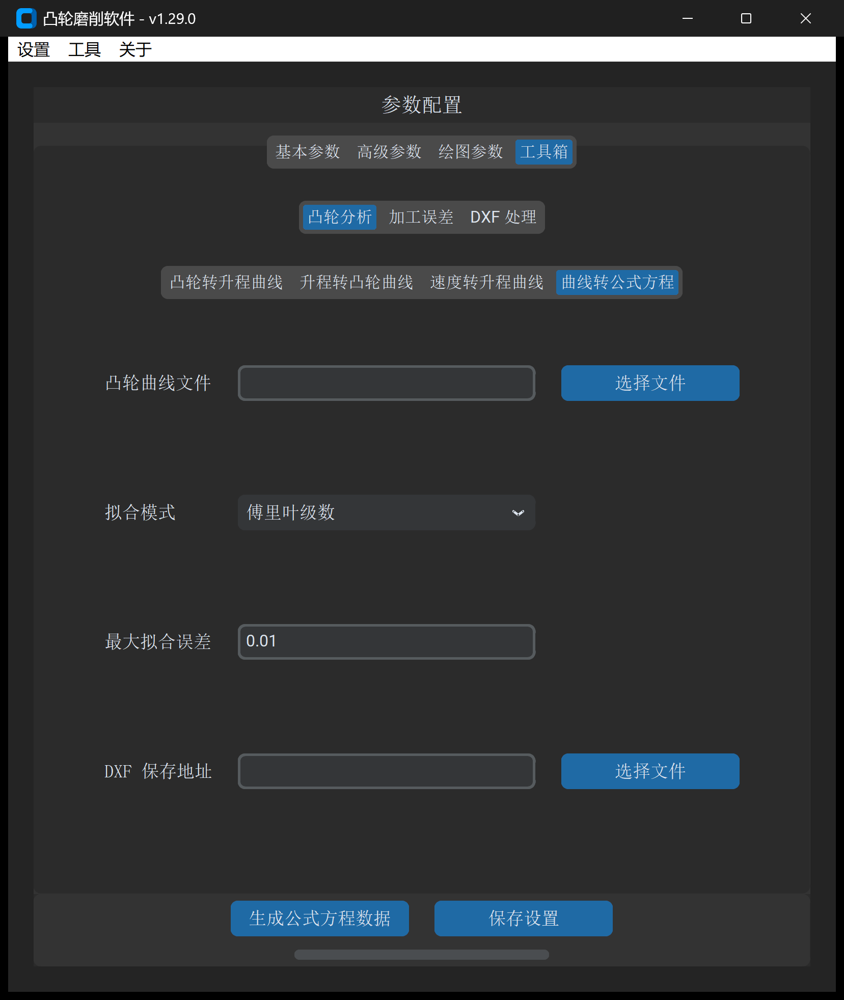

# 曲线转公式方程

“曲线转公式方程”工具用于将离散采样的凸轮 DXF 轮廓曲线，通过高阶数学逼近理论反求为连续、解析的**数学解析方程（Analytical Formulation）**，并评估全轮廓残差分布。

---

## 1. 操作界面与参数布局

打开主界面并切换至 **工具 -> 凸轮分析 -> 曲线转公式方程**：

---

## 2. 参数定义与配置说明

| 参数项 | 字段标识 | 推荐设置 | 详细说明与工程含义 |
| :--- | :--- | :--- | :--- |
| **凸轮曲线文件** | `fit_formula_file_path` | 必填 | 待拟合的闭合或开放凸轮 DXF 轮廓文件路径 |
| **拟合模式** | `fit_formula_mode` | 傅里叶级数 | • **傅里叶级数（Fourier）**：适用于全周闭合周期凸轮轮廓； • **多项式（Polynomial）**：适用于非闭合曲线段或局部分段轮廓 |
| **最大拟合误差** | `fit_formula_accuracy` | `0.001` | 允许的最大逼近残差公差（单位：$\text{mm}$）。系统将根据该容差自适应确定阶数 |

---

## 3. 数学拟合原理与适用模型

### 3.1 傅里叶级数拟合（推荐模式）

对于周期为 $2\pi$ 的闭合外凸轮轮廓，其极径 $r(\theta)$ 天然具备周期对称性。系统展开为有限阶三角级数形式：

$$r(\theta) \approx a_0 + \sum_{k=1}^{N} \Big( a_k \cos(k\theta) + b_k \sin(k\theta) \Big)$$

* **数学优势**：天然满足周向首尾（$0^\circ$ 与 $360^\circ$）的绝对闭合与 $C^\infty$ 无穷阶导数平滑性，彻底消除接刀微观突变；
* **阶数选择**：对于普通偏心凸轮或两凸台凸轮，$N = 8 \sim 16$ 即可收敛至 $0.001\ \text{mm}$ 精度以内；对于多突起凸轮，软件自适应提升展开阶数直至满足最大拟合误差。

### 3.2 最小二乘多项式拟合

对于局部分段曲线或行程开区间凸轮，采用最小二乘法进行正交多项式逼近：

$$y(x) \approx c_0 + c_1 x + c_2 x^2 + \dots + c_M x^M$$

---

## 4. 输出成果与工程应用

点击 **生成公式方程数据** 后，系统将产出以下成果：

1. **数学解析文本（`*.txt`）**：列出基项系数、各项幅值相位以及最终判定最大绝对误差；
2. **数控宏程序 / PLC 算法移植**：工程师可直接将生成的傅里叶或多项式系数代入数控系统底层（如西门子宏程序 R 参数循环、倍福 TwinCAT PLC 运动控制内核），无需在控制器中存储数十万行冗长离散点代码，极大地节省控制器内存并提高计算执行效率。

