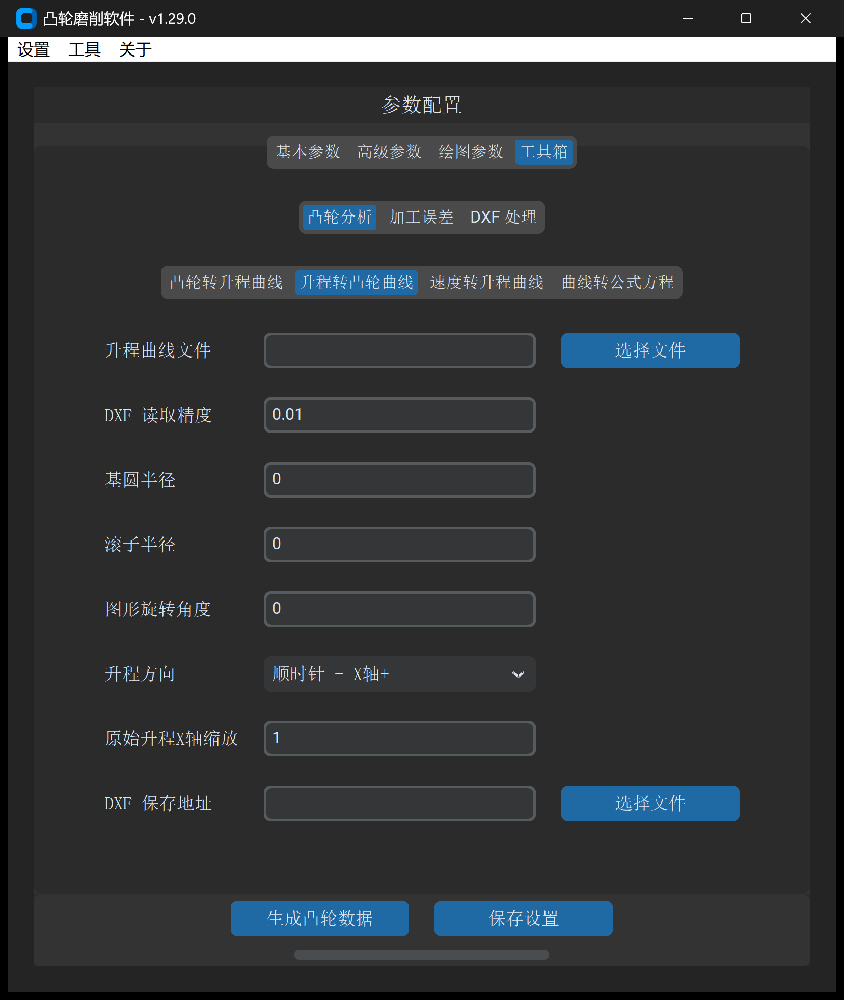

# 升程转凸轮曲线

“升程转凸轮曲线”工具是“凸轮转升程”的逆向工具。它能够根据从动件在各个转角下的**升程离散数据表**，结合指定的**基圆半径**与**机构滚子半径**，自动包络反求出高精度的闭合凸轮二维几何轮廓（DXF）。

---

## 1. 操作界面与参数布局

打开主界面并切换至 **工具 -> 凸轮分析 -> 升程转凸轮曲线**：



---

## 2. 参数定义与配置说明

| 参数项 | 字段标识 | 推荐设置 | 详细说明与工程含义 |
| :--- | :--- | :--- | :--- |
| **升程曲线文件** | `lift_dxf_file_path` | 必填 | 包含转角升程对应关系的文本文件（`.txt` / `.dat` / `.csv`） |
| **基圆半径** | `base_circle_radius` | `20.0` | 凸轮基础圆半径（$\text{mm}$）。升程将在此半径外缘叠加展开 |
| **滚子半径** | `roller_radius` | `0.0` | 从动件滚子半径（$\text{mm}$）：<br>• 若输入的是对心尖顶推杆运动规律，设为 `0`；<br>• 若输入的是滚子推杆的升程规律，输入滚子实际半径，系统将自动通过包络法推算实际凸轮接触工作曲面 |
| **升程方向** | `lift_direction` | 顺时针 | 极坐标展开计算的旋转方向（顺时针 / 逆时针） |
| **DXF 保存地址** | `output_path` | 必填 | 目标生成闭合凸轮 DXF 文件的保存路径 |

---

## 3. 升程输入数据格式规范

升程文本支持两种常用结构，系统能自动识别间隔符号与角度序列：

### 格式 A：标准双列（转角 - 升程）

```text
0.0       0.0000
1.0       0.0052
2.0       0.0210
...
360.0     0.0000
```

### 格式 B：等间隔单列升程（首尾闭合）

```text
0.0000
0.0052
0.0210
0.0475
...
0.0000
```

> [!NOTE]
> 输入的升程数据全周角度范围必须完整覆盖 $0^\circ \sim 360^\circ$。首行数据（$0^\circ$）与尾行数据（$360^\circ$）升程数值必须平滑衔接，避免在接刀点产生非预期的微观台阶。

---

## 4. 几何包络解算原理

对于滚子半径为 $r_r$ 的对心移动滚子从动件凸轮机构：

1. **滚子理论中心轨迹（节线）**：
   $$x_c(\theta) = (R_b + s(\theta)) \cos \theta$$
   $$y_c(\theta) = (R_b + s(\theta)) \sin \theta$$
2. **法向诱导角求解**：通过对轨迹参数微商求取瞬时法向量 $\vec{n}(\theta)$；
3. **工作轮廓包络生成**：将滚子中心向内沿接触法向偏移滚子半径 $r_r$，获得光滑闭合的工作轮廓点集，并输出为 DXF 多段线。

