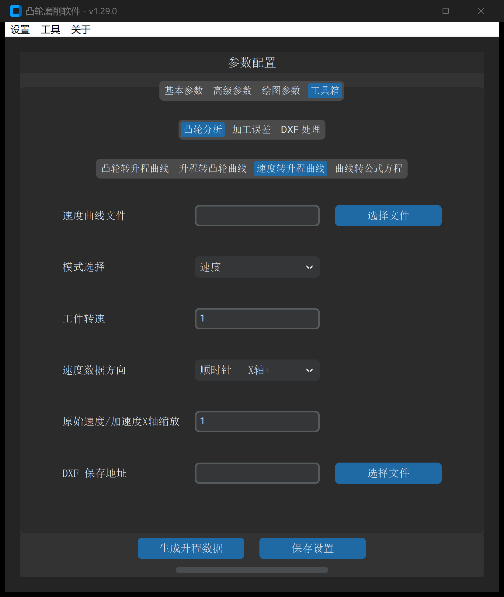
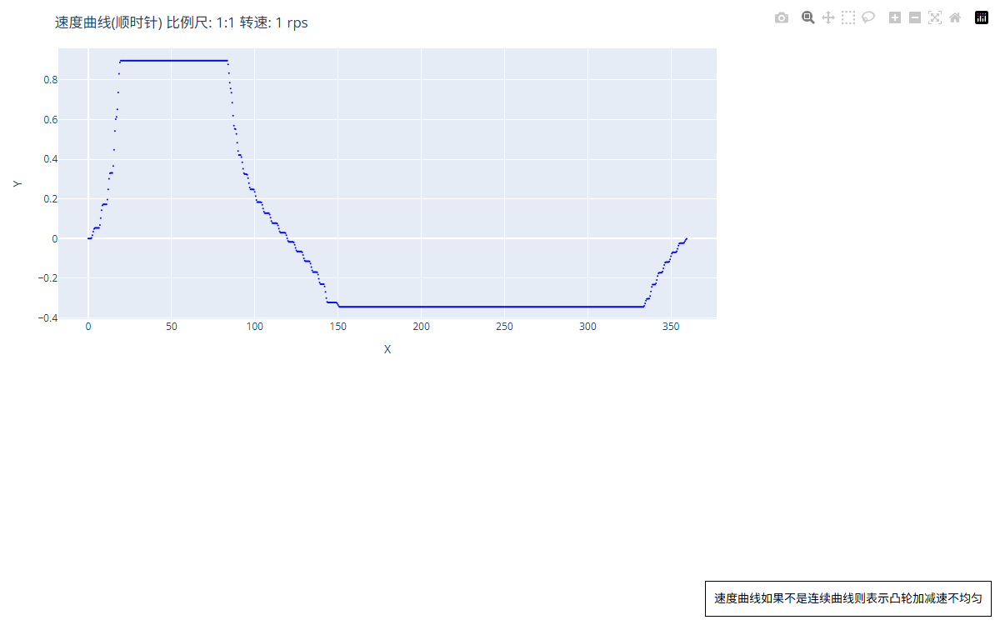

# 速度转升程曲线

“速度转升程曲线”工具用于从机构从动件的**动态速度曲线**或**瞬时加速度曲线**出发，通过严密的数值积分学算法反求出平滑连续的位移升程曲线，并生成交互式运动学评估图表。

---

## 1. 操作界面与参数布局

打开主界面并切换至 **工具 -> 凸轮分析 -> 速度转升程曲线**：

---

## 2. 参数定义与配置说明

| 参数项 | 字段标识 | 推荐设置 | 详细说明与工程含义 |
| :--- | :--- | :--- | :--- |
| **速度曲线文件** | `velocity_acc_file_path` | 必填 | 包含转角与对应速度或加速度值的离散数据文件路径 |
| **模式选择** | `velocity_acc_mode` | 速度 | • **速度**：输入文件为推杆线速度 $v(\theta)$，执行一重数值积分； • **加速度**：输入文件为瞬时加速度 $a(\theta)$，执行双重数值积分 |
| **工件转速** | `rotate_speed` | `100` | 凸轮工作旋转速度（单位：$\text{rpm}$，转/分钟），用于时间域与角度域物理量转换 |
| **原始速度/加速度X轴缩放** | `original_velocity_acc_x_axis_scale` | `1.0` | 生成的交互图表横坐标展开比例 |

---

## 3. 数值积分学与运动学反求原理

在凸轮机构高速运行时，工件恒定角速度为：
$$\omega = \frac{2\pi \cdot n}{60} \quad (\text{rad/s})$$

### 3.1 速度积分模式（一阶积分）

位移升程 $s(\theta)$ 通过梯形数值积分求解：
$$s(\theta) = \int_{0}^{\theta} \frac{v(\phi)}{\omega} \, d\phi$$

### 3.2 加速度积分模式（二阶积分）

通过双重积分分别求得线速度与位移升程：
$$v(\theta) = \int_{0}^{\theta} \frac{a(\phi)}{\omega} \, d\phi, \quad s(\theta) = \int_{0}^{\theta} \frac{v(\phi)}{\omega} \, d\phi$$

### 3.3 零位漂移与周期闭合约束

在离散数据数值积分过程中，微小的离散截断误差容易产生线性漂移，导致 $360^\circ$ 末端位移无法精确回到初始零点。

系统内置了**自适应末端闭合滤波算法**：
$$\tilde{s}(\theta) = s(\theta) - \frac{\theta}{360^\circ} \cdot \Big(s(360^\circ) - s(0^\circ)\Big)$$
确保求得的升程曲线在周向首尾处绝对连续平滑闭合，消除接刀冲击。

---

## 4. 输出成果与交互校验

点击 **生成凸轮数据** 后，系统自动生成多通道交互式运动学波形图：

通过图表可精确比对升程、速度、加速度三个层面的连续性，确保高速运转下机构不发生动力学飞脱或异常抖振。

