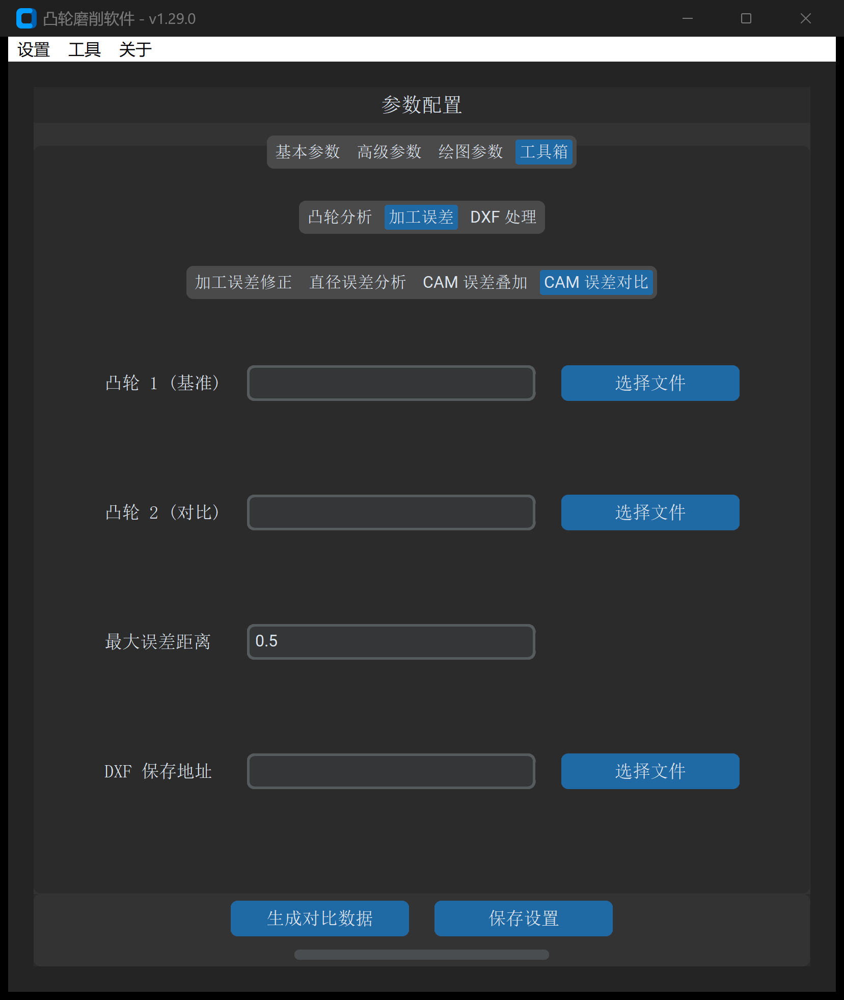

# CAM 误差对比

“CAM 误差对比”工具用于在毫米乃至微米级精度下，对两个独立的闭合凸轮 DXF 轮廓进行**空间几何对齐**与**高保真残差分析**，自动生成残差波形与形位统计指标。

---

## 1. 操作界面与参数布局

打开主界面并切换至 **工具 -> 加工误差 -> CAM 误差对比**：

---

## 2. 参数定义与配置说明

| 参数项 | 字段标识 | 推荐设置 | 详细说明与工程含义 |
| :--- | :--- | :--- | :--- |
| **凸轮 1 (基准)** | `cam_1` | 必填 | 理论基准凸轮 DXF 文件路径（作为误差计算的零基准面） |
| **凸轮 2 (对比)** | `cam_2` | 必填 | 待对比的凸轮 DXF 文件路径（如修调后轮廓、三坐标拟合轮廓） |
| **最大误差阈值** | `max_error_distance` | `0.1` | 形位公差允许上限（$\text{mm}$）。系统将根据该阈值对超差点进行统计与预警过滤 |

---

## 3. 几何对比算法与判据

系统在基准凸轮曲线表面生成等弧长离散测点族，对对比凸轮执行高精度**双向法向投影距离搜寻**：

1. **法向偏差投影**：计算对比曲线上各采样点沿基准法向量的正负距离：
   $$e(\theta) = (\vec{P}_2(\theta) - \vec{P}_1(\theta)) \cdot \vec{n}_1(\theta)$$
2. **形位统计特征量输出**：
   * **最大正偏差（$e_{\max}$）**：凸轮局部材料偏厚的极值点；
   * **最大负偏差（$e_{\min}$）**：凸轮局部欠料/过切的极值点；
   * **全周极差（Peak-to-Valley, $PV$）**：$PV = e_{\max} - e_{\min}$；
   * **均方根残差（Root Mean Square, $RMS$）**：综合反映全轮廓贴合平滑度。

---

## 4. 输出成果与工程应用

点击 **生成对比数据** 后，系统在同目录输出误差对比分析图表及统计报告：

* **全转角残差波形（Plotly 交互视图）**：清晰显示 $0^\circ \sim 360^\circ$ 范围内每处角度的偏差起伏，便于定位机床主轴反向间隙产生的特定角度相位误差；
* **一致性检验**：用于多工位加工一致性对比、工装夹具重复定位精度标定以及算法平滑前后的形变保真度验证。

