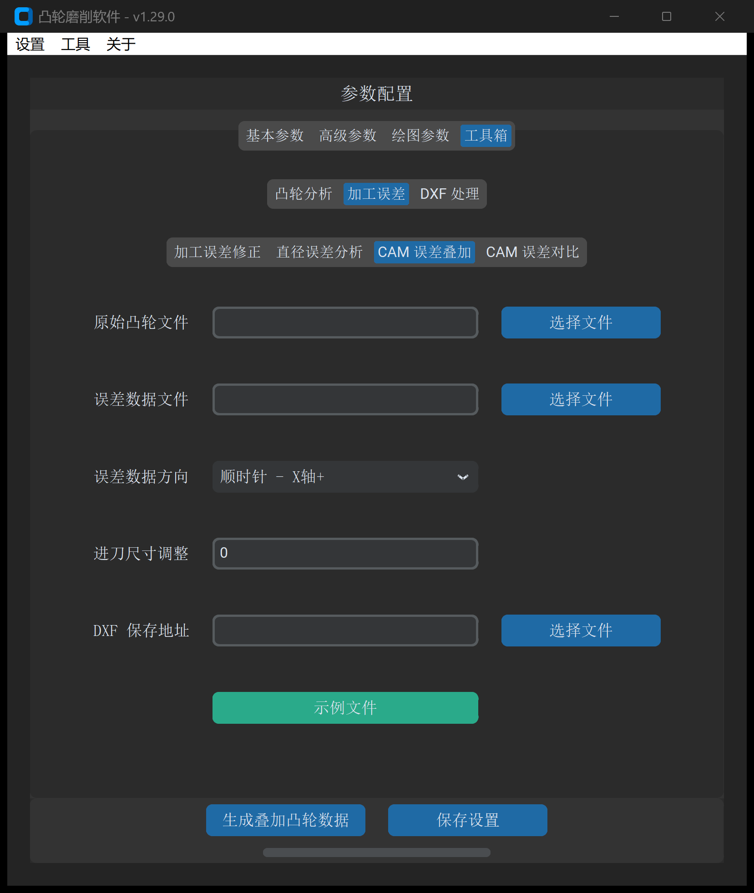

# CAM 误差叠加

“CAM 误差叠加”工具用于将外部测量仪器采集到的离散误差数据表，或有限元（FEA）仿真计算得到的工况变形场，直接叠加到原始凸轮 DXF 轮廓的**法线方向**或**极径方向**，输出重构后的二维凸轮模型。

---

## 1. 操作界面与参数布局

打开主界面并切换至 **工具 -> 加工误差 -> CAM 误差叠加**：



---

## 2. 参数定义与配置说明

| 参数项 | 字段标识 | 推荐设置 | 详细说明与工程含义 |
| :--- | :--- | :--- | :--- |
| **原始凸轮文件** | `original_cam_file` | 必填 | 基础凸轮 DXF 轮廓文件路径 |
| **误差文件** | `error_file` | 必填 | 记录各转角下偏差数值的离散文本文件（`.txt` / `.dat` / `.csv`） |
| **误差方向** | `error_direction` | 法线方向 | • **法线方向**：偏差沿轮廓表面瞬时外法线矢量 $\vec{n}$ 进行物理叠加（最符合磨削切削力作用方向）；<br>• **极径方向**：偏差沿圆心至切点的辐射极径矢量进行叠加 |
| **DXF 保存地址** | `output_path` | 必填 | 叠加重构后的目标凸轮 DXF 文件路径 |

---

## 3. 误差数据文件规范

误差文件支持标准双列结构，单位为毫米（$\text{mm}$），支持正负偏差：

```text
# 角度(deg)   误差量(mm)
0.0          0.0000
10.0         0.0035
20.0         0.0082
30.0         0.0041
...
360.0        0.0000
```

> [!TIP]
> 正值误差代表向外凸起扩展，负值误差代表向内下陷缩进。如果输入的文件仅包含单列等间距误差数据，系统将自动按 $360^\circ$ 均分全周角度。

---

## 4. 典型工程应用场景

1. **结构热弹性变形预补偿**：
   * 在磨削细长多段凸轮轴或薄壁异形凸轮时，磨削力和装夹受力会导致工件产生挠曲弹性退刀；
   * 将 CAE 结构力学仿真计算出的反向变形位移表导入本工具，预先反向叠加生成“预弯/预补偿”工装轮廓，即可抵消切削变形。
2. **测量反求实测再现**：
   * 将克林伯格 P65 导出的跳动误差表叠加回设计图纸，生成工件实际形状的 1:1 精确 CAD 实体，用于装配运动学碰撞复核。

