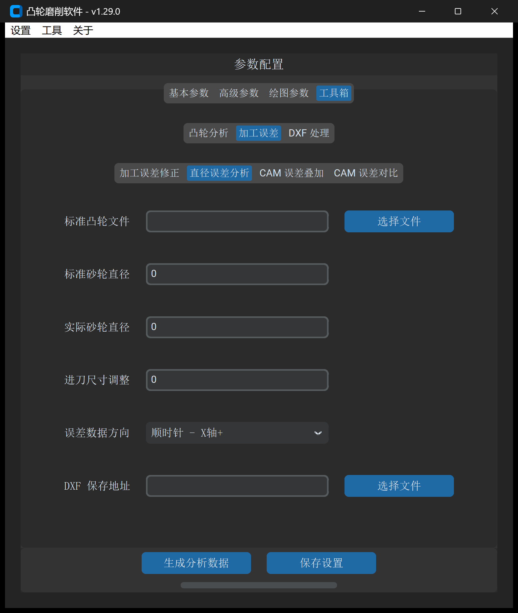
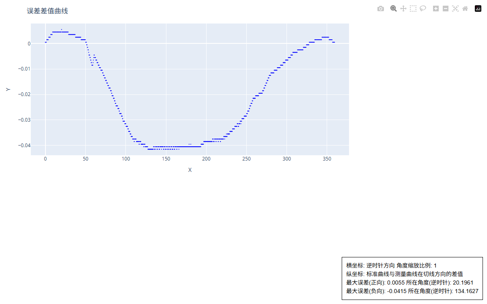

# 直径误差分析

“直径误差分析”工具用于定量仿真和评估：**当实际加工砂轮直径与数控程序理论设定的标准砂轮直径存在偏差时，凸轮工件表面所产生的理论几何畸变与误差敏感度**。

---

## 1. 操作界面与参数布局

打开主界面并切换至 **工具 -> 加工误差 -> 直径误差分析**：

---

## 2. 参数定义与配置说明

| 参数项 | 字段标识 | 示例取值 | 详细说明与工程含义 |
| :--- | :--- | :--- | :--- |
| **标准凸轮文件** | `deviation_analyze_std_file` | `*.dxf` | 零件理论基准轮廓 DXF 文件 |
| **标准砂轮直径** | `wheel_dia_std` | `350.0` | 生成数控代码时所采用的名义理论砂轮直径（$\text{mm}$） |
| **实际砂轮直径** | `wheel_dia_real` | `330.0` | 机床现场磨削使用的当前实际砂轮直径（$\text{mm}$） |
| **砂轮步进** | `wheel_dia_step` | `5.0` | 多直径步进对比分析梯度（$\text{mm}$）。系统将以该步距计算一系列过渡直径下的形位误差包络线 |

---

## 3. 砂轮直径偏差的物理成因与误差形貌

在非圆凸轮外圆磨削中，砂轮中心运动轨迹与凸轮表面切点的几何关系是强非线性的：

$$\vec{r}_{\text{wheel}}(\theta) = \vec{r}_{\text{cam}}(\theta) + R_w \cdot \vec{n}(\theta)$$

当砂轮经过金刚石滚轮多次修整后，实际直径 $2 R_w'$ 逐渐缩小时：
* 若数控系统**未实时重新计算包络线**，仍然沿用针对原直径 $R_w$ 优化的固定插补轨迹；
* 砂轮与工件表面在法向加速度最大的拐点区会产生瞬时包络脱离或欠切，形成极其典型的**“双驼峰 / 蝴蝶翼”形位误差曲线**：

> [!IMPORTANT]
> **双峰误差的工程判读依据**
> 
> * **基圆区域**：误差接近于零，因为圆弧各处的法向曲率恒定，直径偏差仅表现为纯径向平移；
> * **升程段拐点（加速度极值点）**：误差达到极大值，出现对称的双驼峰形貌。若实测发现凸轮升程段存在对称双峰且基圆完好，**应首先怀疑当前使用的砂轮直径与程序设定值不一致**，而非机床导轨精度失准。

---

## 4. 工艺指导与换轮阈值确定

通过直径误差仿真曲线，工艺主管可科学确定换轮修调规范：

1. **确定最大允许修整量**：若产品图纸规定轮廓全跳动为 $\pm 0.005\ \text{mm}$，从图表中读取最大允许砂轮直径缩减量（例如 $\le 8\ \text{mm}$）；
2. **重算程序节点**：当金刚石修整累计量超过该阈值时，必须通过 **Cam Grinding** 重新加载当前实际砂轮直径生成新的数控程序，严禁直接通过修改机床磨削总进给深度进行强行补偿。

