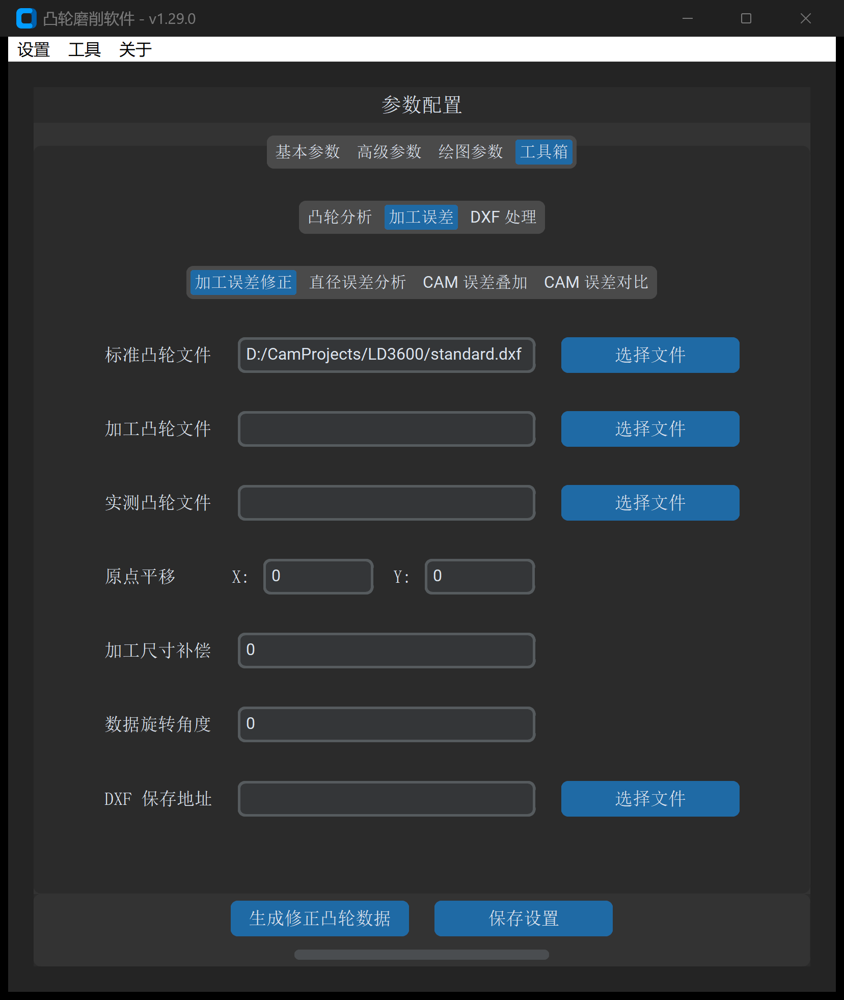
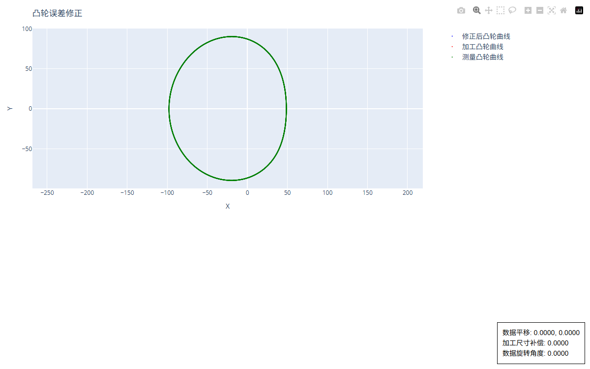

# 加工误差修正

“加工误差修正”是精密凸轮制造工艺中最核心的**闭环迭代补偿工具**。它将设计图纸的“标准理论轮廓”、数控机床使用的“实际加工轮廓”以及测量机采集的“现场实测轮廓”三者进行空间对齐与差分矢量反求，自动生成消减加工变形与机床系统误差的新加工 DXF 轮廓。

---

## 1. 操作界面与参数布局

打开主界面并切换至 **工具 -> 加工误差 -> 加工误差修正**：



---

## 2. 参数定义与配置说明

| 参数项 | 字段标识 | 推荐设置 | 详细说明与工程含义 |
| :--- | :--- | :--- | :--- |
| **标准凸轮文件** | `deviation_fix_std_file` | 必填 | 零件设计图纸的理论基准轮廓 DXF 文件 |
| **加工凸轮文件** | `deviation_fix_program_file_path` | 必填 | 当前数控磨床上用于磨削该试件的 DXF 轮廓（首件通常与标准文件相同；后续修调轮次使用上一版本的加工文件） |
| **实测凸轮文件** | `deviation_fix_data_file_path` | 必填 | 从测量机（P65/三坐标）导出的实测数据文件（支持 DXF 轮廓或转角升程 TXT 数据） |
| **加工尺寸补偿** | `process_size_compensation` | `0.0` | 全局外径尺寸宏观平移量（$\text{mm}$）：<br>• 实测尺寸偏小则输入正值；<br>• 实测尺寸偏大则输入负值 |
| **实测升程方向** | `deviation_fix_data_direction` | 顺时针 | 测量仪导出数据的角度增长方向（顺时针 / 逆时针） |
| **数据旋转角度** | `deviation_fix_data_rotate_angle` | `0.0` | 测量仪装夹基准与机床加工坐标系之间的起始转角相位偏差（度）。正值为顺时针，负值为逆时针 |
| **DXF 保存地址** | `output_path` | 必填 | 闭环修正后的新加工轮廓 DXF 保存路径（建议按版本命名，如 `cam_program_v2.dxf`） |

---

## 3. 三线闭环补偿模型深度解析

在多轮迭代加工中，很多操作人员容易误用“标准轮廓 - 实测偏差”直接覆盖加工，导致前次补偿效果丢失。软件采用规范的**三线闭环补偿架构**：

```
       [标准理论曲线 Standard]
              │
              ├── 空间差分求取误差向量: Δ = Standard - Measured
              │
       [实测测量曲线 Measured]
              │
              ▼
[当前加工曲线 Program_old] ──(+) Δ ──> [修正后新加工曲线 Program_new]
```

### 为什么必须指定“加工凸轮文件”？

1. **首件加工（第 1 轮）**：`加工凸轮文件` = `标准凸轮文件`；
2. **二次修调（第 2 轮）**：若机床仍存在局部微观 $0.005\ \text{mm}$ 余量未磨到位，此时的基底必须是**上一轮机床正在跑的加工文件**，在其基础上追加补偿矢量 $\vec{\Delta}$。只有这样才能实现单调收敛，防止震荡超差。

---

## 4. 误差拟合图表与工程校验

点击 **生成修正凸轮数据** 后，系统将弹出高分辨率误差诊断与修正对照图表：



### 判读重点

1. **残差波峰波谷识别**：观察实测曲线（绿色）相对理论标准（蓝色）的偏离趋势，确定凸轮桃尖与基圆过渡段的变形特征；
2. **修正曲线连续性检查**：修正后的新曲线（橙色）轮廓应过渡平滑，无突刺毛刺。若存在局部剧烈震荡，通常是由于测量数据存在孤立奇异测点，需先对测点进行去噪处理。

