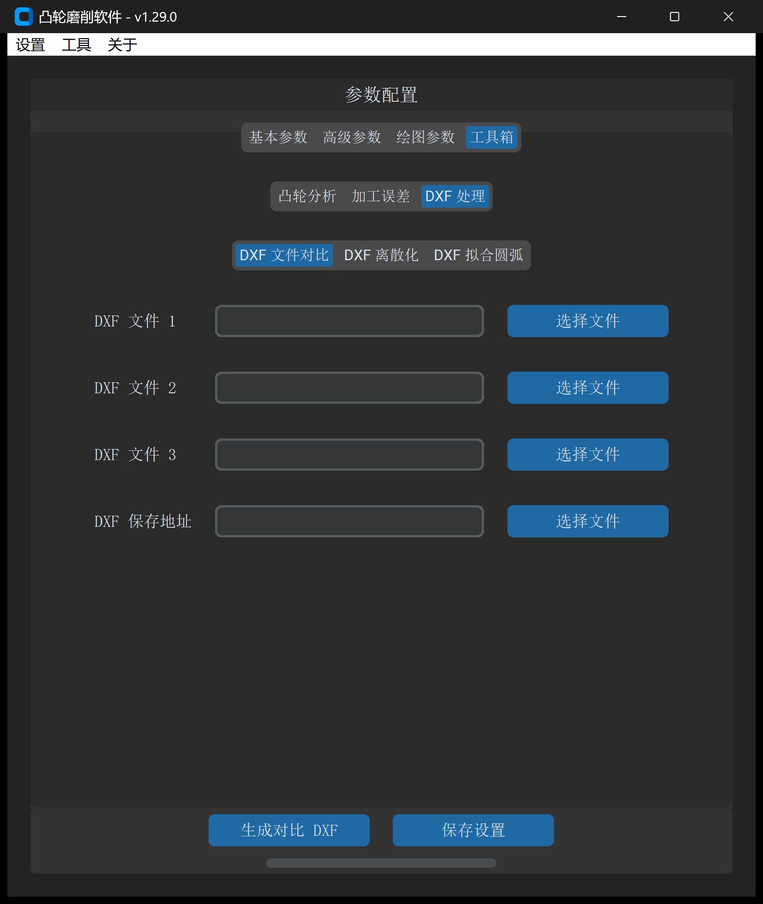
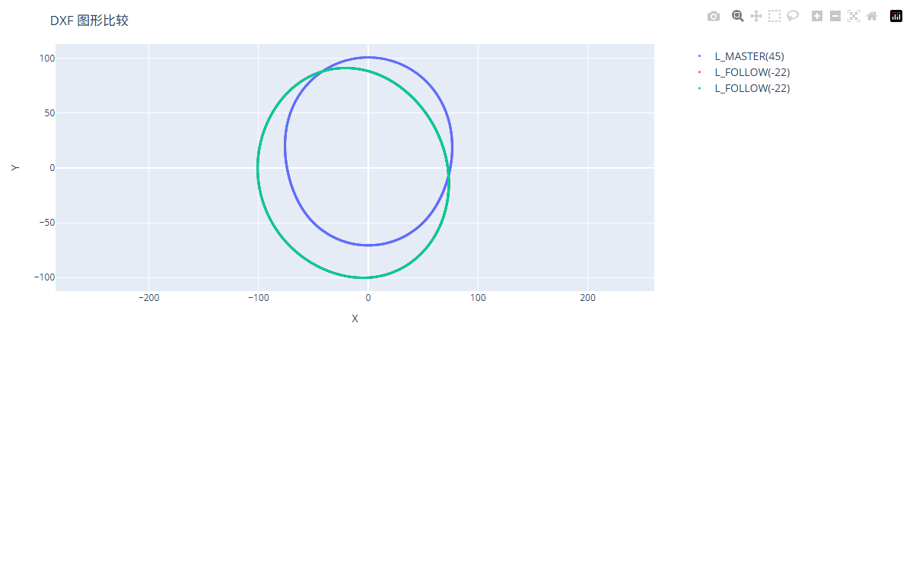

# DXF 文件对比

“DXF 文件对比”工具用于在统一的绝对几何坐标系下，对多达 **3 个不同的 DXF 轮廓**进行矢量叠合显示与高倍率交互比对，帮助工程师快速判别设计变更、相位错动与加工余量分布。

---

## 1. 操作界面与参数布局

打开主界面并切换至 **工具 -> DXF 处理 -> DXF 文件对比**：

---

## 2. 参数定义与配置说明

| 参数项 | 字段标识 | 属性 | 详细说明与推荐配置 |
| :--- | :--- | :--- | :--- |
| **DXF 文件 1** | `compare_dxf_1` | 必填 | 基准参考轮廓（在图表中显示为蓝色曲线） |
| **DXF 文件 2** | `compare_dxf_2` | 必填 | 第 1 对比轮廓（在图表中显示为橙色曲线） |
| **DXF 文件 3** | `compare_dxf_3` | 可选 | 第 2 对比轮廓（在图表中显示为绿色曲线，若无需比对第 3 个文件可留空） |

---

## 3. 交互式矢量叠合视图

点击 **生成对比 DXF** 后，系统将弹出基于 Plotly 引擎的高精度交互比对视图：

### 核心交互功能

* **等比例高倍放大**：锁定 1:1 物理长宽比，使用鼠标滚轮可无损放大至微米级细节，清晰呈现两轮廓之间细微的余量间隙或微观几何突变；
* **图例图层自由切换**：点击图例旁的曲线名称，可单选、多选或瞬时隐藏某条曲线，便于排除视觉干扰；
* **绝对坐标实时悬停探针**：鼠标滑过轮廓时，浮动标签精准显示当前测点的绝对空间坐标 $(X, Y)$。

---

## 4. 典型工程应用场景

1. **圆弧拟合精度校验**：
   * 将原始密集线段 DXF 与通过算法拟合出的圆弧 DXF 共同加载，局部放大检验圆弧与理论曲线的最大脱离量是否满足工艺要求；
2. **多凸轮轴相对相位角校核**：
   * 在双凸轮或多凸轮轴装配图纸中，同时导入进气凸轮与排气凸轮，直观复核二者的夹角相位是否与配气定时图纸一致；
3. **铸造毛坯余量均匀性评估**：
   * 导入粗车毛坯 DXF 与精磨成品 DXF，核验全周各角度下的切削余量是否均匀，避免局部余量过大引起机床烧伤打刀。

