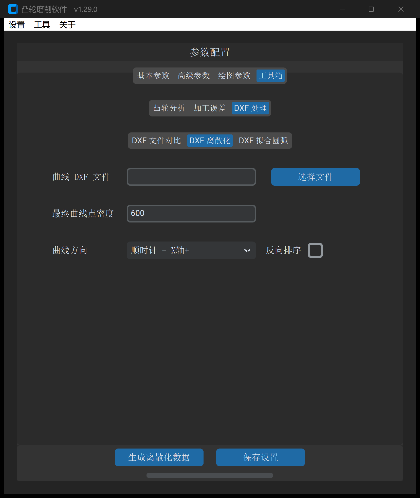

# DXF 离散化

“DXF 离散化”工具用于将外部 CAD 软件导出的复杂凸轮图元（如样条曲线 SPLINE、变曲率多段线、椭圆弧等），按照工业制造规范重新进行**等弧长重采样**与**方向相位标准化重构**。

---

## 1. 操作界面与参数布局

打开主界面并切换至 **工具 -> DXF 处理 -> DXF 离散化**：



---

## 2. 参数定义与配置说明

| 参数项 | 字段标识 | 推荐设置 | 详细说明与工程含义 |
| :--- | :--- | :--- | :--- |
| **凸轮曲线文件** | `dxf_file_path` | 必填 | 包含任意二维图元的原始 DXF 文件路径 |
| **曲线方向** | `discretization_curve_direction`| 顺时针，从X轴正半轴开始 | 规范化重构后的曲线起始点与周向推进顺序（详见第 3 节） |
| **点密度** | `point_density` | `0.1` | 轮廓重采样的等弧长步长间隔（单位：$\text{mm}$）。数值越小点位越密集，通常取 $0.05 \sim 0.2\ \text{mm}$ |
| **点序反转** | `sort_reverse` | 默认不勾选 | 勾选后将最终输出的点位序列执行完全反转（颠倒首尾前进方向） |
| **输出路径** | `output_path` | 必填 | 重构后的规范离散点位文本（`.txt`）或规范 DXF 文件的保存路径 |

---

## 3. 曲线方向与起点重构规范

为了杜绝数控机床在循环加工切入时由于起点错位发生撞刀，软件提供了 6 种标准对齐策略：

```
                    Y 轴正半轴 (90°)
                          ▲
                          │
                          │
  X 轴负半轴 (180°) ───────┼───────► X 轴正半轴 (0°)
                          │
                          │
                          ▼
                    Y 轴负半轴 (270°)
```

1. **顺时针，从 X 轴正半轴开始**（行业首选）：起点强制定位于曲线与 X 轴正半轴交点（$0^\circ$ 处），向第四象限顺时针推进；
2. **顺时针，从 Y 轴正半轴开始**：起点定位于 Y 轴正半轴（$90^\circ$ 处）；
3. **逆时针，从 X 轴正半轴开始**：起点定位于 X 轴正半轴，向第一象限逆时针推进；
4. **逆时针，从 Y 轴正半轴开始**：起点定位于 Y 轴正半轴；
5. **从基圆最低点开始**：自动搜索全周极径最小值的几何平稳区作为切入起点；
6. **保持原图元方向**：仅重采样，不改变 CAD 图元既有起点与方向。

---

## 4. 输出成果与后续应用

点击 **生成离散化数据** 后，软件将输出等间距点位文本或标准化 DXF：

* **消除图元格式壁垒**：彻底将不规则的 AutoCAD 高阶样条转化为标准多段线，避免机床插补器在遇到样条节点时发生降速或报警；
* **点位密度均匀化**：消除 CAD 画图中手绘曲线局部点过疏或过密的问题，为后续高保真圆弧拟合或直接点位插补提供优良的数据基础。

