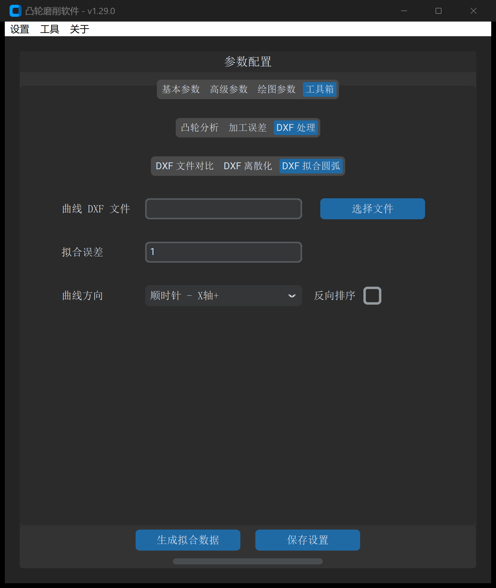

# DXF 拟合圆弧

“DXF 拟合圆弧”工具用于将由数千至数万个微小直线段构成的密集离散凸轮轮廓，在严格保证几何公差的前提下，通过数学优化算法智能合并拟合为由**最少数量的圆弧（Arc）与直线（Line）组成的切向连续轮廓**。

---

## 1. 操作界面与参数布局

打开主界面并切换至 **工具 -> DXF 处理 -> DXF 拟合圆弧**：

---

## 2. 参数定义与配置说明

| 参数项 | 字段标识 | 推荐设置 | 详细说明与工程含义 |
| :--- | :--- | :--- | :--- |
| **凸轮曲线文件** | `dxf_file_path` | 必填 | 待拟合的离散凸轮 DXF 轮廓文件路径 |
| **拟合误差** | `fit_arcs_accuracy` | `1.0` | 几何逼近公差阈值（**基准单位：$0.1\ \mu\text{m}$**）： • 设置为 `1.0` 对应实际最大残差 $\le 0.1\ \mu\text{m}$（$0.0001\ \text{mm}$）； • 设置为 `5.0` 对应最大残差 $\le 0.5\ \mu\text{m}$； • 数值越小越逼近原图，但圆弧段数会相应增加；**`1.0` 为高精度磨削推荐平衡值** |
| **G 代码反向** | `g_code_reverse` | 默认不勾选 | 勾选后，若输出数控加工代码，将把圆弧插补指令中的 `G02`（顺圆）与 `G03`（逆圆）进行全局对调 |
| **输出路径** | `output_path` | 必填 | 拟合生成的精简圆弧 DXF 轮廓或 NC 代码保存路径 |

---

## 3. 算法特性与数控优势

### 3.1 Numba JIT 高性能双向公差带拟合

软件底层集成由 Numba 预编译的高性能几何拟合内核（`calc.py`）：
* **自适应贪婪合并**：从基准点出发，向后动态扩展测点区间，通过最小二乘法实时求取局部最佳拟合圆心与半径；
* **极值残差拦截**：只要当前段内任何单个测点到拟合圆弧的径向法向距离超过给定的“拟合误差”，立即截断当前圆弧，平滑开启下一段圆弧的搜索与求解；
* **一阶切向平滑衔接**：在圆弧与圆弧、圆弧与直线的过渡节点，强制执行切向斜率约束，消除拐点折角。

### 3.2 离散点 vs 圆弧拟合性能对比

| 指标维度 | 密集离散短线段（G01） | 智能拟合圆弧（G02/G03） |
| :--- | :--- | :--- |
| **程序代码行数** | 3,600 ~ 10,000 行冗长代码 | **仅需 40 ~ 80 行圆弧指令** |
| **程序文件体积** | 几百 KB ~ 数 MB | **小于 10 KB（压缩率达 90% 以上）** |
| **数控前瞻处理速度** | 易引发插补缓冲区欠刀降速 | 数控系统前瞻极度轻松，运行高速流畅 |
| **工件表面微观光洁度** | 存在微观多边形多面棱面折线 | **理论曲率连续圆润，达到镜面磨削效果** |

---

## 4. 操作与成果验证

1. 导入待拟合的 DXF 文件，设置拟合误差为 `1.0`；
2. 指定保存路径，点击 **生成拟合数据**；
3. 生成完毕后，可配合 **[DXF 文件对比](dxf_compare.md)** 工具，将原始离散 DXF 与拟合后的圆弧 DXF 叠加比对，并在高倍放大下核验关键拐点区域的贴合度。

