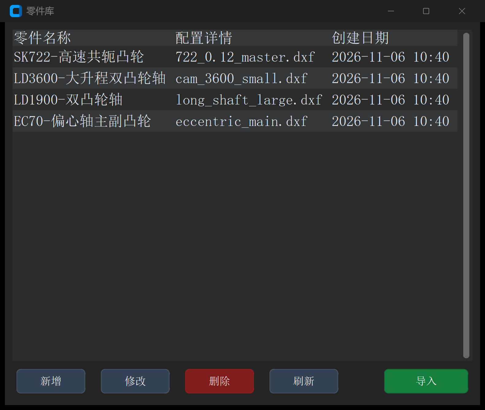

# 零件库与配置管理

在多品种、小批量的凸轮柔性磨削生产中，不同批次的工件具有各自独立的几何尺寸、砂轮规格、进给速度与机床配方。如果每次换线加工都需要重新手动输入数十个参数，不仅费时费力，还容易出现人为差错。

**Cam Grinding** 内置了标准化的“零件库（Parts Library）”管理系统，能够将当前软件环境的所有参数（包含基本参数、高级算法、绘图设置、工具箱配置）打包归档为命名零件，支持一键秒级调取、备份与跨机台迁移。

---

## 1. 零件库管理界面总览

在软件顶部主菜单栏点击 **零件库**（或使用快捷键 `Ctrl + P`）即可呼出管理弹窗：



---

## 2. 界面元素与操作功能说明

| 控件名称 | 对应操作 / 字段 | 详细功能说明 |
| :--- | :--- | :--- |
| **零件信息列表** | 列表视图表格 | 展示当前已归档的全部工件记录，包含三列核心属性：<br>• **零件名称**（`part_list_col_name`）；<br>• **配置类别**（`part_list_col_config`）；<br>• **修改时间**（`part_list_col_date`） |
| **添加（`btn_add`）** | 新增当前配方 | 弹出命名对话框，将当前主界面所有标签页正在生效的参数完整捕获并另存为一个全新工件 |
| **修改（`btn_modify`）** | 重命名工件 | 选中目标零件记录，修改其显示名称或备注信息 |
| **删除（`btn_delete`）** | 移除废弃配方 | 弹出防误触确认框，从本地数据库中永久删除选中工件的配置文件 |
| **导入（`btn_import`）** | 外部配方载入 | 支持从外部 U 盘或共享目录一键导入其他机台导出的标准 `.json` 工件配置包 |
| **刷新（`btn_refresh`）** | 磁盘重载同步 | 手动触发本地磁盘文件扫描，刷新列表显示 |
| **载入（双击或确定）** | 激活所选工件 | 选中目标零件并点击“确定”或直接双击行，软件自动将该零件的全部工艺参数瞬间注入回主界面各大标签页中 |

---

## 3. 底层存储机制与数据组织架构

零件库数据存储于用户本地应用数据目录下：
`C:\Users\<Current_User>\.camgrind\PartsLibrary\`

每个归档零件均在独立的子目录下维护三套核心解耦的 JSON 配置文件：

```
PartsLibrary/
└── SK722-高速共轭凸轮/
    ├── main_config.json      # 基本参数、高级参数、砂轮外径、插补公差与代码生成设置
    ├── draw_config.json      # XY点位索引、CAM数据文件规则、图形变换及共轭摆臂几何参数
    └── tool_config.json      # 凸轮分析、加工误差修正、直径分析及DXF工具箱特定配方
```

> [!TIP]
> **车间机台工艺标准化建议**
> 
> * **统一工件命名法**：推荐采用 `产品型号-特征描述-工艺版本` 规范命名（例如 `SK722-高速共轭-V1`、`EC70-偏心轴-精磨`），杜绝以临时人员名字或模糊代号命名；
> * **跨设备快速克隆**：若车间引进了相同规格的新机床，可直接打包拷贝 `PartsLibrary` 文件夹至新机台对应目录，点击“刷新”即可实现百种产品工艺配方的秒级同步！

