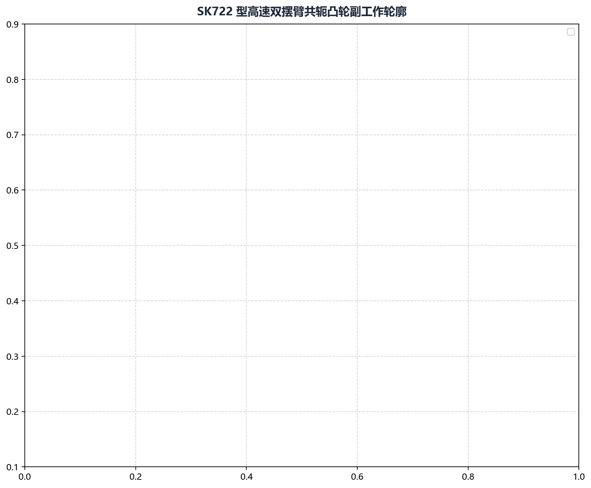

# 案例一：SK722 高速共轭凸轮设计磨削

本案例介绍在高速纺织机械与高频自动化凸轮分割器中，如何应用 **Cam Grinding** 完成 **SK722 高速共轭凸轮对** 的正向机构包络求解、圆弧拟合平滑以及最终数控精磨全流程。

---

## 1. 工程背景与技术难点

* **零件规格**：SK722 高速共轭打纬凸轮副（主凸轮 + 共轭副凸轮）；
* **服役工况**：主轴工作转速 $\ge 650\ \text{rpm}$，双摆臂滚子共轴铰接夹持；
* **关键技术瓶颈**：
  * 主副凸轮之间必须实现理论上的**零侧隙贴合**。若存在局部大于 $0.01\ \text{mm}$ 的间隙，高速换向时滚子将脱离接触并发生猛烈撞击；若局部过盈，则将导致滚子轴承瞬间抱死烧蚀；
  * 原设计图纸仅提供了主凸轮 CAD 轮廓，要求工艺工程师反求出几何精准匹配的副凸轮。

---

## 2. 核心机构设计参数

```
机构几何参数表：
• 摆臂回转中心距 L   : 110.0 mm (位于凸轮中心右侧)
• 随动滚子半径 r_r   : 16.0 mm
• 主凸轮摆臂长度 l₁   : 75.0 mm
• 副凸轮摆臂长度 l₂   : 75.0 mm
• 双摆臂几何夹角 γ   : 60.0° (从摆臂 1 转向摆臂 2 为逆时针正向)
```

---

## 3. 全流程实战操作步骤

### 步骤 1：求解副凸轮共轭工作廓线

1. 启动软件，切换至 **绘图参数 -> CAM 共轭计算** 标签页；
2. 导入主凸轮理论轮廓：`D:/CamProjects/SK722/sk722_main_cam.dxf`；
3. 准确输入机构几何参数：
   * 摆臂中心距：`110.0`
   * 滚子半径：`16.0`
   * 凸轮1摆臂长度：`75.0`
   * 凸轮2摆臂长度：`75.0`
   * 摆臂夹角：`60.0`
4. 指定导出路径：`D:/CamProjects/SK722/sk722_conjugate_sub.dxf`；
5. 点击 **生成凸轮数据**，求解器通过相对运动反转与接触包络算法自动计算出副凸轮轮廓。

### 步骤 2：装配运动学协同与间隙仿真

求解完成后，软件自动输出两凸轮同台咬合装配图表：



* **图面核验**：确认全转角范围内，摆臂 1 与摆臂 2 的连杆末端均能严密包络主副凸轮工作面，不存在局部自相交尖点或脱离现象。

### 步骤 3：DXF 智能圆弧拟合

1. 切换至 **工具 -> DXF 处理 -> DXF 拟合圆弧**；
2. 分别加载 `sk722_main_cam.dxf` 和 `sk722_conjugate_sub.dxf`；
3. 将拟合误差设定为 `1.0`（对应 $0.1\ \mu\text{m}$ 亚微米精度）；
4. 点击 **生成拟合数据**，将数千个微小线段压缩为 52 段光滑相切圆弧，消除微多边形切削振痕。

### 步骤 4：生成数控精磨代码

1. 切换至 **代码生成** 模块；
2. 配置当前磨床砂轮参数：
   * 砂轮最大直径：`350.0`，最小直径：`300.0`，当前直径：`346.5`；
   * 插补精度：`0.001`；
   * 生成模式勾选“圆弧拟合”；
3. 点击 **生成程序代码**，导出标准西门子 NC 磨削程序。

---

## 4. 实测效果与验收成果

* **程序代码精简**：加工程序由原始的 4,800 行压缩至 96 行，数控系统前瞻运算极为顺畅；
* **间隙指标达标**：试磨并在实机装配后，使用塞尺全周检测双滚子间隙，全行程实测最大游隙 $\le 0.004\ \text{mm}$，在 $650\ \text{rpm}$ 满负荷转速下平稳静音运转。

