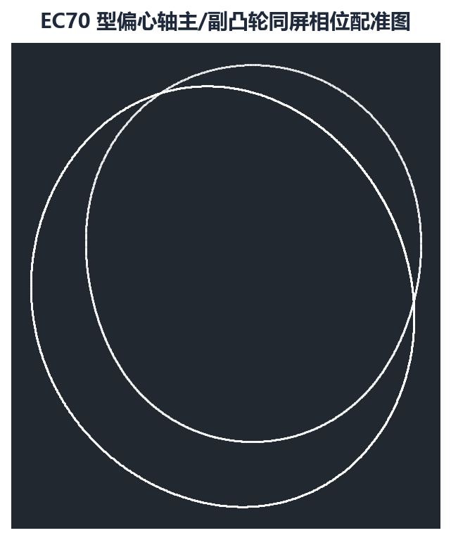

# 案例二：EC70 偏心轴主副凸轮配对

本案例针对流体泵阀与内燃机执行机构中常见的 **EC70 偏心轴双凸轮总成**，演示如何基于设计院提供的升程数据表，正向重构凸轮工作廓线，并通过图形变换与多 DXF 矢量叠合完成主副凸轮相对相位配对。

---

## 1. 工程背景与技术难点

* **零件规格**：EC70 组合式偏心凸轮轴（包含 1 轴段主偏心轮与 2 轴段从动偏心轮）；
* **输入依据**：仅持有机械设计手册升程表（包含 $0^\circ \sim 360^\circ$ 升程数列，Excel 格式）及基圆要求；
* **技术瓶颈**：
  * 主凸轮与副凸轮之间存在严苛的 $72.5^\circ$ 空间几何相位差；
  * 滚子中心节线与凸轮实际磨削表面存在法向几何偏差，手工偏置易在拐点发生自相交干涉。

---

## 2. 设计规范参数表

| 设计参数项 | 参数取值 | 说明 |
| :--- | :--- | :--- |
| **理论基圆半径 $R_b$** | `32.0 mm` | 偏心轴基础圆柱段名义半径 |
| **随动滚子半径 $r_r$** | `15.0 mm` | 柱塞挺柱滚轮实际接触半径 |
| **主副凸轮相对相位差** | `72.5°` | 主副凸轮工作峰值偏角（逆时针） |
| **磨削预留余量** | `0.15 mm` | 粗磨后单边精磨切深 |

---

## 3. 全流程实战操作步骤

### 步骤 1：基于升程表正向建模生成主凸轮

1. 启动软件，切换至 **绘图参数 -> CAM 数据文件**；
2. 载入原始升程数据表格：`D:/CamProjects/EC70/ec70_lift_table.xlsx`；
3. 参数设定：
   * 数据角度方向：选择“逆时针”；
   * 数据类型：选择“相对值”（自动消除基圆零点漂移）；
   * 勾选“绘制升程图形”；
   * 基圆半径输入：`32.0`；
4. 指定导出路径为 `ec70_cam_main.dxf`，点击 **生成凸轮数据**。

### 步骤 2：重构副凸轮几何轮廓

1. 切换至 **绘图参数 -> CAM 图形变换**；
2. 导入刚刚生成的主凸轮 DXF；
3. 将 **图形旋转角度** 设置为 `-72.5`（实现相位超前顺时针偏移）；
4. 导出为副凸轮文件 `ec70_cam_sub.dxf`。

### 步骤 3：多 DXF 空间叠合核验

1. 切换至 **工具 -> DXF 处理 -> DXF 文件对比**；
2. 在“DXF 文件 1”载入 `ec70_cam_main.dxf`；
3. 在“DXF 文件 2”载入 `ec70_cam_sub.dxf`；
4. 点击 **生成对比 DXF**：

* **交互测量**：在生成的比对视图中，使用角度与距离探针测量两波峰之间的夹角，确认读数精确等于 $72.50^\circ$，且各处轮廓光滑圆润。

### 步骤 4：下发加工与参数归档

1. 在“代码生成”模块中配置双轴加工程序，分别输出主副凸轮的数控代码；
2. 打开“零件库”，点击 **添加**，将该产品工艺命名为 `EC70-偏心轴主副凸轮` 存盘归档。

---

## 4. 成果评估

* **反求速度提升**：原本需在 3D CAD 中反复构建曲面和投影耗时半天的型线展开，软件在 10 秒内即可完成解析求解与 DXF 输出；
* **相位对齐无误差**：成品偏心轴装车实测，气阀定时误差小于 $0.05^\circ$，完全达到主机厂一级精度标准。

