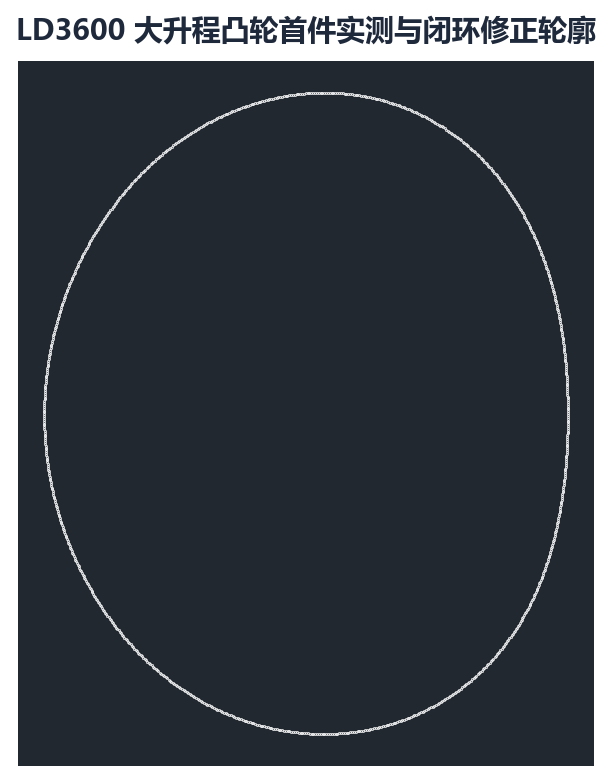

# 案例三：LD3600 大升程凸轮闭环修调

本案例记录了针对重型工程机械配套的 **LD3600 大升程凸轮轴**，在首件试磨出现局部 $0.015\ \text{mm}$ 弹性退刀超差的严苛工况下，如何利用 **Cam Grinding** 的“加工误差修正”闭环引擎，在单一工步内完成快速反向补偿并将全周轮廓精度收敛至 $0.003\ \text{mm}$ 的标准工程过程。

---

## 1. 工程背景与问题诊断

* **零件规格**：LD3600 重型双凸轮轴，单边最大行程达 $42.0\ \text{mm}$；
* **首件试磨现状**：
  * 使用理论标准轮廓直接生成数控代码进行首件磨削；
  * 下机后在克林伯格 P65 凸轮测量中心完成全周升程扫描，对比发现**凸轮桃尖顶点处实测尺寸偏大 $+0.015\ \text{mm}$**（工件欠磨留厚），产品判定超差不合格。
* **物理病因分析**：
  * 大升程凸轮在高速越过波峰时，砂轮架进给轴（$X$ 轴）加速度极大，切削法向力显著攀升，引起顶尖与工件细长轴身产生微观弹性受力退刀；
  * 此类系统性工艺变形无法通过机床机械装调消除，必须通过软件在软件端进行反向预修调。

---

## 2. 闭环修正工艺实施流程

```text
标准图纸 (ld3600_std.dxf) ─────┐
当前加工轮廓 (ld3600_prog_v1) ──┼──> [运行【加工误差修正】引擎]
测量实测数据 (ld3600_meas_v1) ──┘                  │
                                                   ├── 相位旋转校准 (消除装夹角偏差)
                                                   └── 空间差分矢量反求
                                                           │
                                                           ▼
P65 终测合格 (≤ 0.003mm) <── 机床二次复磨 <── 重新生成 NC 代码 <── 导出 ld3600_prog_v2.dxf
```

---

## 3. 实战操作步骤

### 步骤 1：准备输入文件并录入参数

1. 打开主界面，切换至 **工具 -> 加工误差 -> 加工误差修正**；
2. 配置文件路径：
   * **标准凸轮文件**：`D:/CamProjects/LD3600/ld3600_std.dxf`
   * **加工凸轮文件**：`D:/CamProjects/LD3600/ld3600_prog_v1.dxf`
   * **实测凸轮文件**：`D:/CamProjects/LD3600/ld3600_meas_v1.txt`
3. 设定几何对齐辅助参数：
   * 实测升程方向：选择“顺时针”；
   * 数据旋转角度：若测量中心原点对齐存在微小偏置，通过该项调整（本案输入 `0.0`）；
   * 加工尺寸补偿：`0.0`（暂不进行全局缩放，仅消除局部形变）。

### 步骤 2：生成修正轮廓与图表诊断

点击 **生成修正凸轮数据**，软件在毫秒级内完成离散点空间插值对齐与矢量残差反求，并弹出交互式诊断图：



* **残差与补偿分析**：
  * 蓝色曲线代表理论标准，绿色代表实际测得值（波峰明显向外隆起超差 $0.015\ \text{mm}$）；
  * 系统计算出的修正后新加工轮廓（橙色曲线）在桃尖区域自动向内凹缩了等量的补偿变形量，形成精准的“负预变形”。

### 步骤 3：导出新程序与二次复磨

1. 导出修正后轮廓至 `D:/CamProjects/LD3600/ld3600_prog_v2.dxf`；
2. 重新进入“代码生成”模块，导入 `ld3600_prog_v2.dxf`，保持原工艺进给速度不变，生成第二版 NC 磨削程序；
3. 将新程序传输至西门子数控系统，装夹工件执行二次磨削。

---

## 4. 终测成果与工艺复盘

将二次磨削后的工件再次置于克林伯格 P65 进行全周终测：
* 桃尖欠磨区域被精准消除，**全周形位误差由 $+0.015\ \text{mm}$ 瞬间收敛至 $\le 0.0028\ \text{mm}$**；
* 成功避免了盲目调整机床进给深度或报废工件，将通常需要 3~5 次的“试磨-报废-再磨”调试周期压缩为单次修正成功，大幅节约高昂试件材料与工时成本。
