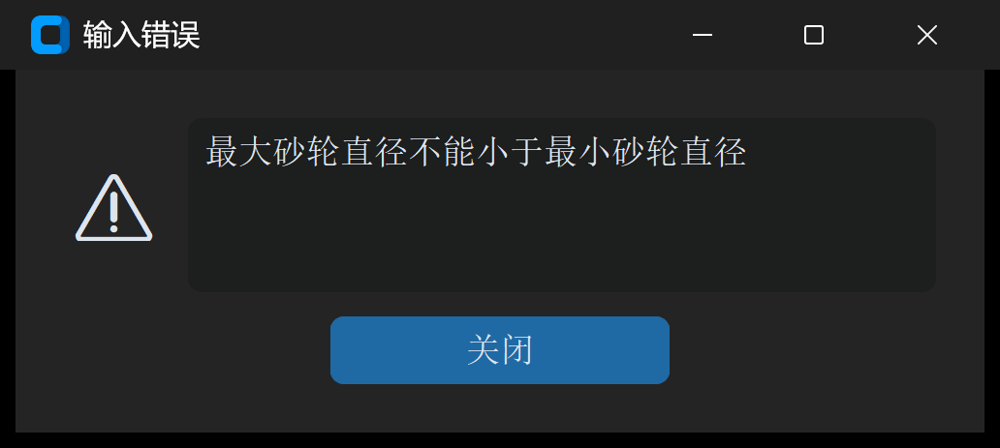

# 故障排除与报警速查

在使用 **Cam Grinding** 进行凸轮建模、DXF 解析、代码生成以及机床加工调试过程中，若遇到参数校验拦截、系统报警或现场加工缺陷，可参考本章提供的速查表与标准处置方案进行排查。

---

## 1. 软件校验报警速查表

当输入的几何参数或硬件环境不符合系统运行约束时，软件将弹出报警对话框（如下图所示）：



| 报警提示文本 | 触发原因与物理机制 | 排除与纠正方法 |
| :--- | :--- | :--- |
| **最大砂轮直径不能小于最小砂轮直径**<br>（`error_message_dia_setting`） | 在“基本参数”配置中，“最大砂轮直径”的数值被设置为小于或等于“最小砂轮直径” | 检查砂轮卡尺实测规格，确保：<br>`最大砂轮直径` $>$ `最小砂轮直径` |
| **DXF 读取精度设置过大**<br>（`error_message_segment_length`） | “DXF 读取精度”设置过大（例如 $> 2.0\ \text{mm}$），超过了凸轮轮廓局部微小拐角特征的极限弦长 | 降低读取精度数值，推荐设置为 `0.05` 或 `0.10`（mm） |
| **输入参数有误，请检查！**<br>（`invalid_input_text`） | 任意参数输入框中包含了非法字符（如字母、全角符号、空格）或关键必填项留空 | 检查所有输入框，确保必须为半角浮点数（如 `15.5`），且无多余空格 |
| **未检测到加密狗或已断开连接**<br>（`auth_error_dongle_disconnected`） | 硬件加密锁未插入 USB 接口、USB 供电不足或驱动程序被系统安全软件拦截 | 重新插拔加密锁，确认指示灯常亮；若仍报警，重新安装 Sentinel 驱动包 |
| **未找到有效授权许可证**<br>（`auth_error_no_valid_license`） | 本地尚未导入 `.lic` 授权文件，或许可证与当前计算机硬件指纹不匹配 | 重新获取机器码，联系技术支持生成配套的专用许可证并重新导入 |
| **授权已过期**<br>（`license_expired`） | 租约版许可证已超出有效终止日期 | 联系软件发行方申请许可证延期或升级为永久授权 |

---

## 2. DXF 图元导入故障排查

| 异常现象 | 底层原因分析 | 推荐解决方案 |
| :--- | :--- | :--- |
| **导入后提示“轮廓未闭合”** | CAD 图纸中曲线起点与终点之间存在微米级微小开缝（Gap）或交叉飞边 | 1. 在 AutoCAD 中输入 `PEDIT` -> `Join` 执行封闭；<br>2. 或直接使用本软件 **[DXF 离散化](../6_toolbox_dxf/dxf_discretization.md)** 自动按闭合多段线重采样 |
| **解析后图形严重变形或缺失部分弧段** | DXF 文件中包含未打散的高阶三维多段线（`POLYLINE 3D`）或嵌套图块引用（`BLOCK`） | 在 CAD 软件中全选图元，执行 `EXPLODE`（打碎）指令，另存为 **AutoCAD 2000 DXF** 纯二维格式 |
| **图形严重偏离屏幕中心** | CAD 绘图时工件旋转轴心未定位于坐标绝对原点 $(0, 0)$，带有绝对偏移量 | 在 CAD 中使用 `MOVE` 指令，捕捉工件回转旋转中心，将其平移至绝对坐标 `(0, 0)` 点 |

---

## 3. 数控磨削现场缺陷与对策

```
常见现场缺陷对照处置：
• 工件表面有微观棱纹 / 振痕  ===> 启用【DXF 拟合圆弧】(误差 0.1μm)，替代离散点位插补
• 内凹处局部过切 / 形状失真 ===> 运行【凸轮转升程】，检查凹部最小曲率半径，更换小直径砂轮
• 机床进给轴剧烈顿挫 / 欠刀 ===> NC 程序头开启 COMPCAD 压缩器与 FIFOCTRL 预读
• 首件试磨局部欠磨 (超差)   ===> 运行【加工误差修正】闭环反求工具，单步消除弹性退刀
```

### 3.1 表面微多边形棱纹（振痕）

* **成因**：使用了纯离散点直线插补（`G01`），数控系统在微小直线拐点处产生细微加减速波动；
* **对策**：在代码生成或 DXF 工具箱中勾选 **拟合圆弧**，将拟合误差设为 `1.0`（$0.1\ \mu\text{m}$），生成相切圆弧（`G02/G03`）指令，彻底消除棱面。

### 3.2 凹形凸轮过切报废

* **成因**：实际使用的砂轮外径大于凸轮凹形部位的理论曲率半径（$\Phi_{\text{wheel}} > 2 \cdot \rho_{\min}$）；
* **对策**：严禁强行加工！必须通过 **[凸轮转升程](../4_toolbox_analysis/cam_to_lift.md)** 工具查看曲率分布图，准确读取最小曲率半径，更换满足安全裕度的小直径砂轮。

### 3.3 加工尺寸系统性超差

* **成因**：工件细长产生切削弹性退刀、或装夹对刀存在相位偏差；
* **对策**：严格执行 **[案例三](../8_workflows_cases/case3_large_lift_error_fix.md)** 示范的闭环修正规范，采集克林伯格 P65 实测数据进行三线反向补偿重构。

